# Hướng dẫn hiện thực toàn bộ API Discover Mars

Ngày lập: **02/11/2026**. Áp dụng cho repository `D:\Mar_Survival`.

Đây là tài liệu triển khai theo từng bước, chưa phải thông báo các endpoint đã tồn tại. Các model mới, trường mới, endpoint, service và trạng thái được ghi là đề xuất để hiện thực. Việc tạo tài liệu này không sửa model và không chạy migration lên database ứng dụng.

Tên module dùng thống nhất là **Discover Mars**. Giữ nguyên tên project/namespace đang có là `Mars_Survival_Hanbook` khi chạy lệnh; tên database là `MarsSurvivalHandbook`, tên DbContext là `MarsDbContext`.

## Mục lục

1. [Hiện trạng và kết quả cần đạt](#step-01)
2. [Phạm vi và các quyết định thiết kế](#step-02)
3. [Kiến trúc và cấu trúc thư mục](#step-03)
4. [Bổ sung model và ràng buộc](#step-04)
5. [Migration, chuyển dữ liệu cũ và database update](#step-05)
6. [Seed danh mục và cấu hình](#step-06)
7. [Xác thực và phân quyền](#step-07)
8. [NASA endpoints và mẫu phản hồi](#step-08)
9. [Import, chống trùng và khôi phục job](#step-09)
10. [Lọc và chuẩn hóa dữ liệu](#step-10)
11. [Duyệt nguồn và xử lý nguồn thay đổi](#step-11)
12. [Bản nháp, snapshot và duyệt bài](#step-12)
13. [Publish và bảo vệ nội dung công khai](#step-13)
14. [Hợp đồng API công khai](#step-14)
15. [Hợp đồng API quản trị](#step-15)
16. [Validation, lỗi và vận hành](#step-16)
17. [Kiểm thử và tiêu chí nghiệm thu](#step-17)
18. [Chạy thử xuyên suốt](#step-18)
19. [Thứ tự thực hiện và checklist bàn giao](#step-19)
20. [Nguồn tham khảo](#references)

<a id="step-01"></a>
## 01. Hiện trạng và kết quả cần đạt

### 01.1. Những phần repository đã có

| Thành phần | Hiện trạng khi lập tài liệu |
| --- | --- |
| Backend | ASP.NET Core 8, controller-based API |
| ORM/database | EF Core 8.0.33, SQL Server |
| Model | 41 entity, 21 enum; có bài, nguồn, fact, measurement, mission, media, review và import job |
| DbContext | `Data/MarsDbContext.cs`, đã đăng ký trong `Program.cs` |
| Design time | `Data/MarsDbContextFactory.cs` |
| Migration | `20261031160146_InitialCreate` |
| Database mặc định | `(localdb)\MSSQLLocalDB`, database `MarsSurvivalHandbook`, Windows Authentication |
| EF CLI | `dotnet-tools.json` ở gốc repository, phiên bản 8.0.33 |
| Swagger | Đã cấu hình cho Development |
| Xác thực | Có package JwtBearer; chưa có đầy đủ cấu hình authentication/login trong `Program.cs` |
| Discover Mars services/controllers | Chưa hiện thực |

Các file cần đọc trước: [Program.cs](../Backend/Mars_Survival_Hanbook/Program.cs), [DbContext](../Backend/Mars_Survival_Hanbook/Data/MarsDbContext.cs), [models](../Backend/Mars_Survival_Hanbook/Models/README.md), [hướng dẫn migration](../Backend/Mars_Survival_Hanbook/Data/README.md), [đặc tả dự án](Mars_Survival_Handbook.pdf).

### 01.2. Kết quả cuối cùng

- Guest xem module, 5 chủ đề, bài chi tiết, timeline, mission, địa danh, fact, phép đo và nguồn đã công bố.
- Admin nhập nguồn hoặc khởi chạy import, biên tập bài và gửi reviewer.
- Admin xác minh nguồn, dữ liệu khoa học và đúng phiên bản bài.
- Admin xuất bản/gỡ xuất bản và quản lý connector.
- Import cùng dữ liệu nhiều lần không tạo nguồn trùng.
- Nguồn cập nhật tạo revision mới; nội dung công khai giữ nguyên đến khi có quyết định xuất bản.
- API công khai hoạt động bằng database nội bộ khi NASA không truy cập được.
- Có lịch sử migration, OpenAPI, bộ request kiểm thử và kiểm thử database.

Không đưa bookmark, so sánh công nghệ hay module sinh tồn khác vào phạm vi hướng dẫn này. Bản đồ tương tác là phần mở rộng được mô tả đầy đủ nhưng có thể triển khai sau luồng đọc bài cơ bản.

<a id="step-02"></a>
## 02. Phạm vi và các quyết định thiết kế

### 02.1. Taxonomy cố định cho Discover Mars

Module slug: `discover-mars`.

| Category slug | Tên hiển thị | Dữ liệu chính | Nguồn |
| --- | --- | --- | --- |
| `exploration-history` | Lịch sử khám phá Sao Hỏa | Bài và timeline sự kiện | NASA mission pages, NTRS |
| `structure-and-terrain` | Cấu tạo và địa hình | Bài, địa danh, tọa độ, lớp bản đồ | NASA Mars Facts, PDS, Mars Trek |
| `atmosphere-temperature-gravity` | Khí quyển, nhiệt độ, trọng lực | Fact, phép đo, bối cảnh | Mars Facts, NTRS, PDS/MEDA |
| `water-and-life` | Nước và dấu hiệu sự sống | Bài, bằng chứng, giới hạn kết luận | NASA Science/SWIM, NTRS, PDS |
| `missions-and-rovers` | Sứ mệnh NASA và tàu thăm dò | Mission, thiết bị, ngày và trạng thái | NASA mission pages, PDS context, NASA Images |

Mỗi category có ít nhất một bài thật đã duyệt trước nghiệm thu. Các con số trong ví dụ hợp đồng nội bộ ở tài liệu này là dữ liệu minh họa, không phải nội dung để seed khoa học.

### 02.2. Các quyết định dùng trong hướng dẫn

1. Giao diện nội dung ban đầu là tiếng Việt (`vi`); schema vẫn giữ khả năng dịch.
2. Khóa chính nội bộ dùng GUID. Mã NASA lưu thành chuỗi, không dùng làm khóa chính của ứng dụng.
3. Chấp nhận nguồn NASA và nguồn NASA đồng tác giả/đồng thực hiện sau khi reviewer xác minh; giữ nguyên tác giả, tổ chức và credit. Không tự công nhận một tài liệu chỉ vì nó nằm trên domain NASA. Đây là chính sách triển khai đề xuất, cần ghi rõ trong cấu hình `AccessPolicy`.
4. Nếu dự án chọn chính sách tất cả tác giả phải thuộc NASA, đổi quy tắc kiểm duyệt; không sửa affiliation để làm dữ liệu đạt điều kiện.
5. Source là danh tính ổn định; SourceRevision là một phiên bản cụ thể. Các bài published ghim đúng revision.
6. Nội dung phiên bản bài bất biến; trạng thái review có thể thay đổi qua hành động được phân quyền.
7. Toàn bộ API công khai đọc dữ liệu của phiên bản đang được công bố, kể cả title/summary trong tìm kiếm, fact, mission và credit.
8. Không gọi NASA trong request đọc bài, tìm kiếm hoặc mở module.

### 02.3. Phân biệt ba loại dữ liệu

| Dữ liệu | Ví dụ | Cách dùng |
| --- | --- | --- |
| Raw | JSON NASA, XML label, PDF, file đo | Lưu để kiểm tra lại và parse; không trả công khai trực tiếp |
| Working data | Fact đang biên tập, mission vừa cập nhật, revision Pending | Dùng cho CMS và tạo snapshot |
| Published snapshot | Nội dung đúng phiên bản reviewer đã duyệt | Nguồn đọc của API công khai |

<a id="step-03"></a>
## 03. Kiến trúc và cấu trúc thư mục

```mermaid
flowchart LR
    NASA[NASA APIs và tài liệu] --> C[Connectors]
    C --> J[Job và item staging]
    J --> S[Source + SourceRevision]
    S --> N[Chuẩn hóa và kiểm chứng]
    N --> D[Bài nháp + snapshot]
    D --> R[Duyệt đúng phiên bản]
    R --> P[PublishedVersionId]
    P --> Q[API công khai]
```



Cấu trúc đề xuất, không tạo tất cả file bằng các class rỗng:

```text
Backend/Mars_Survival_Hanbook/
  Controllers/
    AuthController.cs
    DiscoverMarsController.cs
    Admin/DiscoveryImportsController.cs
    Admin/DiscoverySourcesController.cs
    Admin/DiscoveryContentController.cs
    Admin/DiscoveryArticlesController.cs
    Admin/DiscoveryReviewsController.cs
  Contracts/
    Auth/
    DiscoverMars/
    Admin/
    Common/
  Services/
    Discovery/
    Ingestion/
    Sources/
    Editorial/
  Integrations/Nasa/
    Images/
    Ntrs/
    Pds/
    MarsTrek/
  BackgroundJobs/
  Data/Configurations/
  Data/Migrations/
  Models/
```

- Controller: bind request, authentication/authorization, status code; không chứa quy tắc import hoặc publish.
- Service: nghiệp vụ, kiểm tra quyền theo tài nguyên, transaction, kiểm tra xung đột.
- Connector: HTTP client và DTO NASA; không trả EF entity hoặc tự publish.
- `Contracts`: DTO request/response của ứng dụng, tách khỏi NASA DTO và EF entity.
- Worker: xử lý job bền vững đã lưu trong DB. Không dùng task chạy nền chỉ nằm trong bộ nhớ của request.
- Dùng `MarsDbContext` hiện có; không bắt buộc thêm generic repository nếu chỉ làm lớp bao quanh EF.

<a id="step-04"></a>
## 04. Bổ sung model và ràng buộc

Phần này phải được hiện thực trước khi tạo migration ở bước 05. Các bảng/trường dưới đây chưa có sẵn trong repository, trừ khi ghi rõ là hiện có.

### 04.1. Danh tính nguồn: mở rộng ScientificSource

Giữ `Id` và các liên kết hiện tại. Bổ sung:

| Trường | Kiểu dự kiến | Ý nghĩa |
| --- | --- | --- |
| `Provider` | enum `SourceProvider` | Ntrs, Images, Pds, NasaWeb, MarsTrek, ManualLegacy |
| `IdentityKey` | string, tối đa 450 | Định danh đã chuẩn hóa, duy nhất trong provider |
| `LastCheckedAt` | DateTimeOffset? | Lần gần nhất kiểm tra nguồn |
| `CurrentAcceptedRevisionId` | Guid? | Revision được chọn làm bản đã chấp nhận hiện hành |

Quy tắc identity:

| Provider | IdentityKey |
| --- | --- |
| Ntrs | `citation:` + citation ID |
| Images | `asset:` + nasa_id |
| Pds | `lid:` + LID không có hậu tố phiên bản `::...` |
| NasaWeb | `url:` + SHA-256 của canonical URL |
| MarsTrek | Hash của endpoint đã chuẩn hóa + layer identifier |
| ManualLegacy | `legacy:` + GUID của source cũ, nếu không xác định được nguồn gốc |

Tạo unique index `(Provider, IdentityKey)`. Chọn collation cho IdentityKey bảo toàn các phần phân biệt hoa/thường; chuẩn hóa hostname nhưng không lowercase toàn bộ path hoặc external ID. Không cắt chuỗi để vừa cột.

`ExternalRecordId` vẫn lưu mã gốc để hiển thị/đối chiếu. Không dùng `ConnectorId` làm danh tính provider: hai connector cấu hình khác nhau có thể nhập cùng một tài liệu.

Các trường `Title`, `Authors`, `Url`, `VerificationStatus` hiện có trên ScientificSource có thể giữ làm thông tin tra cứu của bản đã chấp nhận. Không cập nhật chúng bằng dữ liệu Pending rồi dùng để hiển thị citation của bài published.

### 04.2. Tạo SourceRevision

| Trường | Kiểu dự kiến | Quy tắc |
| --- | --- | --- |
| `Id` | Guid | Kế thừa Entity |
| `SourceId` | Guid | FK đến ScientificSource |
| `RevisionNumber` | int | Tăng trong cùng source; lớn hơn 0 |
| `ProviderVersion` | string? | Phiên bản NASA công bố, nếu có |
| `ContentHash` | string 64 | SHA-256 của nội dung đã chuẩn hóa, chưa bao gồm provider version |
| `Fingerprint` | string 64 | Hash của ContentHash + ProviderVersion + phiên bản quy tắc chuẩn hóa |
| `NormalizationVersion` | string | Ví dụ `source-v1`; xác định cách tạo fingerprint |
| `MetadataSnapshot` | JSON string | Title, URL, tác giả, affiliation, DOI, credit, ngày công bố, loại tài liệu |
| `RawStoragePath` | string? | Đường dẫn nội bộ tới phản hồi/file gốc bất biến |
| `RawChecksum` | string? | Hash bytes gốc; khác ý nghĩa ContentHash |
| `IngestionJobId` | Guid? | Job đầu tiên tạo revision |
| `RetrievedAt` | DateTimeOffset | Thời điểm truy xuất, UTC |
| `VerificationStatus` | enum hiện có | Pending, Accepted, Rejected |
| `VerifiedById`, `VerifiedAt` | Guid?, DateTimeOffset? | Bắt buộc nếu Accepted |
| `VerificationNotes` | string? | Kết quả kiểm tra tác giả/nguồn/quyền |
| `RevokedAt`, `RevocationReason` | thời gian?, string? | Thu hồi một revision đã từng được chấp nhận khi phát hiện vấn đề |

Unique `(SourceId, RevisionNumber)` và `(SourceId, Fingerprint)`. Revision nội dung bất biến; chỉ metadata của quyết định duyệt/thu hồi được đổi qua service. Không tự tăng revision bằng `Count + 1` ngoài transaction.

Nếu một revision gồm JSON metadata, PDF và các file liên quan, RawStoragePath trỏ tới manifest nội bộ liệt kê file version/checksum. Không chỉ giữ JSON tìm kiếm rồi mất khả năng đối chiếu PDF đã dùng.

Với nguồn đổi A → B → A và fingerprint trùng revision cũ, tái sử dụng revision đã biết, ghi nhận lần quan sát mới trong IngestionItem. Không tự hạ `CurrentAcceptedRevisionId` về bản cũ hoặc đổi bài published.

Thêm alternate key `(Id, SourceId)` trên SourceRevision. Con trỏ `ScientificSource.CurrentAcceptedRevisionId` phải tham chiếu revision thuộc đúng source bằng FK ghép; cho phép null để tạo Source trước rồi Revision sau. Dùng `DeleteBehavior.NoAction` cho các FK.

### 04.3. Tạo IngestionItem để staging và retry từng mục

| Nhóm | Các trường |
| --- | --- |
| Định danh | Id, JobId, ItemKey, Provider, IdentityKey? |
| Nội dung | RawPayload hoặc RawStoragePath, RawChecksum, NormalizedPayload?, NormalizationVersion |
| Kết quả | SourceId?, SourceRevisionId?, Status, ErrorCode?, ErrorMessage? |
| Thực thi | AttemptCount, NextAttemptAt?, CompletedAt? |

`Status` đề xuất: Queued, Processing, Unchanged, RevisionCreated, Rejected, Failed. `ItemKey` là định danh ổn định trong job; dùng locator của nguồn cho cả item thiếu ID để ghi lỗi. Unique `(JobId, ItemKey)`.

Mở rộng IngestionJob với `RequestKey`, `RequestHash`, `RequestJson`, `CheckpointJson`, `LeaseOwner`, `LeaseExpiresAt`, `NextAttemptAt` nếu worker cần retry/phân trang. RequestKey dùng cho endpoint tạo job; không dùng thay khóa chống trùng nguồn. Unique theo `(RequestedById, ConnectorId, RequestKey)` cho request do người dùng khởi tạo.

`RecordsAccepted` hiện có nghĩa là mục đã chuẩn hóa/nhận vào staging thành công, không có nghĩa reviewer đã Accepted. Các bộ đếm phải theo cùng định nghĩa số item riêng biệt; cập nhật CHECK constraint nếu bổ sung RecordsUnchanged/RecordsFailed. Không dùng bộ đếm để chứng minh nội dung đã publish.

### 04.4. Mở rộng Article và ArticleVersion

| Model | Thay đổi |
| --- | --- |
| Article | Thêm `PublishedVersionId?`, `CurrentDraftVersionId?`, `RequiresReview` |
| ArticleVersion | Thêm `SnapshotSchemaVersion`, `SnapshotHash`, `ReviewState`, `ReviewedById?`, `ReviewedAt?` |
| ArticleVersionSource mới | `ArticleVersionId`, `SourceId`, `SourceRevisionId`; PK `(ArticleVersionId, SourceRevisionId)` |

`ArticleVersion.ReviewState` dùng enum riêng `ArticleVersionReviewState`: Draft, InReview, Approved, ChangesRequested, Rejected, Superseded. Không dùng tên này để thay enum `ReviewState` của ReviewTask.

`ArticleVersion.Snapshot` hiện có trở thành toàn bộ nội dung phiên bản, bao gồm giá trị và citation. `Snapshot`, `SnapshotHash`, `ArticleId`, số Version và dependency links không được sửa sau khi tạo. Thay đổi tạo ArticleVersion mới. Trạng thái duyệt và dấu thời gian được cập nhật riêng, không tính trong SnapshotHash.

`ReviewTask.ArticleVersionId` hiện có được giữ nguyên. Một phiên bản được gửi duyệt phải có đủ các dependency đã đóng băng. Không cho sửa bảng ArticleVersionSource trong lúc đang duyệt.

Ràng buộc:

- Hai con trỏ phiên bản trên Article phải trỏ tới ArticleVersion của chính bài đó. Dùng alternate key `(ArticleVersion.Id, ArticleVersion.ArticleId)` hiện có và FK ghép.
- ArticleVersionSource phải trỏ đúng cặp `(SourceRevisionId, SourceId)`.
- Giữ unique `(ArticleId, Version)` hiện có.
- `Status == Published` phải có PublishedVersionId, người/ngày review và người/ngày publish.
- Snapshot phải là JSON hợp lệ và đúng schema version mà ứng dụng hiểu.
- Tạo Article với con trỏ null, tạo version và dependency links, sau đó đặt con trỏ trong cùng transaction để tránh vòng FK khi insert.

### 04.5. Gắn dữ liệu làm việc với provenance

Thêm SourceRevisionId cho ScientificFact, Measurement, MediaAsset, Mission, MarsLocation, ExplorationEvent, MapLayer. Dùng FK ghép với SourceId hiện có để không liên kết nhầm source. Bắt đầu nullable cho backfill; yêu cầu giá trị cho dữ liệu mới được đưa vào snapshot duyệt.

`ArticleSource` của bản đang biên tập cũng cần SourceRevisionId; mapping snapshot chính xác cuối cùng nằm ở ArticleVersionSource. Giữ ClaimNote, EvidenceType và TestEnvironment ở cấp claim.

ResearchPaper đang có unique SourceId: giữ vai trò metadata tra cứu hiện hành, không tạo ResearchPaper trùng SourceId mỗi lần có revision. Các metadata lịch sử của paper nằm trong SourceRevision.MetadataSnapshot và snapshot bài.

MediaAsset đang có unique NasaId: không clone MediaAsset với cùng NasaId để lưu phiên bản ảnh. Giữ asset identity, lưu bytes/file version theo revision và đưa URL/file hash cụ thể vào snapshot.

### 04.6. Quan hệ bổ sung cho đủ 5 chủ đề

Thêm bảng liên kết cho bản làm việc: `ArticleMission`, `ArticleLocation`, `ArticleExplorationEvent`, `ArticleMapLayer`, `ArticleMeasurement`. Mỗi bảng dùng PK ghép ArticleId + ID đối tượng. Đối tượng khi đưa vào version phải được chụp đủ trường và provenance trong snapshot.

MapLayer bổ sung `Style`, `ResourceUrlTemplate`, `BoundingBoxJson`, `CoordinateSystem`, `CapabilitiesStoragePath` nếu triển khai bản đồ. Measurement bổ sung `ExternalObservationKey`, `QualityFlag`, `QualityNotes` để nhập PDS có chọn lọc. Khóa phép đo phải phân biệt revision nguồn, instrument, đại lượng và sample; timestamp một mình không đủ.

Module nếu cần ảnh bìa riêng thì thêm `CoverMediaAssetId?`. Nếu chưa thêm, dùng ảnh bài giới thiệu đã publish làm ảnh card module, không giả định Module đã có trường ảnh.

### 04.7. File cần cập nhật cùng model

1. Thêm class vào nhóm Models phù hợp; thêm DbSet trong MarsDbContext.
2. Khai báo PK/FK/index trong Data/Configurations; không để EF tự sinh shadow FK do nhiều navigation trỏ cùng entity.
3. Cập nhật CHECK constraints theo enum và trạng thái mới.
4. Thêm guard bất biến trong service/SaveChanges interceptor cho snapshot và revision payload. Các đường bulk SQL/ExecuteUpdate cũng phải tuân thủ; không mở endpoint cập nhật trực tiếp chúng.
5. Không coi `RowVersion` là cơ chế lưu lịch sử: nó chỉ phát hiện cập nhật cạnh tranh.

**Đầu ra bước 04:** model, configuration và kế hoạch backfill hoàn chỉnh; chưa xóa InitialCreate hoặc database cũ.

<a id="step-05"></a>
## 05. Migration, chuyển dữ liệu cũ và database update

### 05.1. Kiểm tra đúng project và database

Chạy trong PowerShell:

```powershell
cd D:\Mar_Survival\Backend\Mars_Survival_Hanbook
dotnet tool restore
dotnet restore
dotnet ef dbcontext info --context MarsDbContext
dotnet ef migrations list --context MarsDbContext
```

Kết quả phải là provider SQL Server, server `(localdb)\MSSQLLocalDB`, database `MarsSurvivalHandbook`. Nếu có biến môi trường/user secrets ghi đè connection string, xác nhận đích thực tế trước update. Không dùng tên database làm `--context`.

### 05.2. Migration mở rộng schema

Sau khi thực hiện thay đổi model bước 04, tạo migration đầu tiên cho phần mở rộng. Với DB có dữ liệu, để trường identity/revision mới nullable trong giai đoạn này và chưa tạo unique index chặn dữ liệu chưa backfill.

```powershell
dotnet build
dotnet ef migrations add AddDiscoverMarsVersioning --context MarsDbContext --output-dir Data/Migrations
dotnet ef migrations script InitialCreate AddDiscoverMarsVersioning --context MarsDbContext --output migration-discover-mars-review.sql
```

Đọc `Up`, `Down` và SQL sinh ra. Kiểm tra các cột, bảng mới, FK ghép, không có DropTable/DropColumn ngoài chủ đích. Kiểm thử migration trên database tạm và bản sao có dữ liệu trước khi update database làm việc.

Sau khi kiểm tra đạt, chạy **bước bắt buộc áp dụng schema**:

```powershell
dotnet ef database update AddDiscoverMarsVersioning --context MarsDbContext
```

Tương đương trong Visual Studio Package Manager Console; chọn một cách, không tạo cùng migration hai lần:

```powershell
Add-Migration AddDiscoverMarsVersioning -Context MarsDbContext -OutputDir Data/Migrations -Project Mars_Survival_Hanbook -StartupProject Mars_Survival_Hanbook
Update-Database AddDiscoverMarsVersioning -Context MarsDbContext -Project Mars_Survival_Hanbook -StartupProject Mars_Survival_Hanbook
```

### 05.3. Backfill dữ liệu cũ, không giả mạo lịch sử review

Viết một tác vụ backfill có thể chạy lại, có dry-run và báo cáo; đó là tác vụ cần hiện thực, chưa có sẵn command trong repo.

1. Backup DB đang có dữ liệu. Tạm dừng worker và thao tác CMS trong cửa sổ chuyển đổi; API cũ có thể đọc cho đến lúc chuyển đồng bộ sang schema mới.
2. Liệt kê nguồn trùng theo identity đề xuất. Kiểm tra nội dung, quyền và các FK trước khi gộp.
3. Với nguồn trùng, chọn bản canonical và remap FK trong transaction. Khi bảng liên kết bị trùng PK, hợp nhất bản giống nhau; ClaimNote/evidence khác nhau phải giữ để rà soát, không xóa tùy ý.
4. Tạo identity và revision đầu tiên cho từng source. Không nhận diện được provider thì dùng ManualLegacy, trạng thái Pending.
5. Không suy diễn ngày review hoặc reviewer. Chỉ kế thừa trạng thái Accepted nếu có bằng chứng lịch sử tương ứng với chính nội dung được lưu.
6. Gắn SourceRevisionId vào dữ liệu có provenance xác định. Thiếu provenance thì giữ staging/Pending, không tạo giá trị giả để vượt constraint.
7. Chuyển dữ liệu bài cũ thành snapshot mới theo schema. Snapshot cũ chỉ chứa nội dung text không chứng minh các fact hiện tại đã được duyệt: không tự công khai snapshot mới đó.
8. Bài trước đây Published nhưng không dựng lại được phiên bản đã duyệt phải được reviewer kiểm tra lại trước khi chuyển sang đường đọc mới; lưu bản chụp để đối chiếu và báo cáo riêng.
9. Đối chiếu số bản ghi, FK, citation, trạng thái published và báo cáo khác biệt. Nếu DB chỉ có schema trống, ghi nhận backfill không có dữ liệu để xử lý.

### 05.4. Migration siết ràng buộc sau backfill

Cập nhật model/configuration: IdentityKey bắt buộc, unique index provider/identity, CHECK publication mới và các FK/NOT NULL đã đủ điều kiện. Không đặt NOT NULL cho trường của legacy chưa xử lý rồi để migration thất bại.

```powershell
dotnet ef migrations add EnforceDiscoverMarsIntegrity --context MarsDbContext --output-dir Data/Migrations
dotnet ef migrations script AddDiscoverMarsVersioning EnforceDiscoverMarsIntegrity --context MarsDbContext --output migration-discover-mars-integrity.sql
dotnet ef database update EnforceDiscoverMarsIntegrity --context MarsDbContext
dotnet ef migrations has-pending-model-changes --context MarsDbContext
dotnet ef migrations list --context MarsDbContext
```

Hai file SQL là artifact kiểm tra của lần triển khai, không phải file đã được tạo cùng tài liệu này. Không chạy script và command update bằng hai tiến trình đồng thời.

### 05.5. Kiểm tra trong SSMS

Kết nối Server Name `(localdb)\MSSQLLocalDB`, Windows Authentication, rồi refresh Databases. Instance `MSI` là một đích khác.

```sql
SELECT MigrationId, ProductVersion
FROM dbo.__EFMigrationsHistory
ORDER BY MigrationId;
```

Phải thấy migration mới đã áp dụng, không chỉ InitialCreate. Kiểm tra các bảng SourceRevisions, ArticleVersionSources, IngestionItems theo tên mapping đã chọn.

### 05.6. Lưu ý cho EF Core 8 và test hiện có

- Giữ InitialCreate và toàn bộ lịch sử migration đã áp dụng. Không dùng EnsureCreated trên database ứng dụng quản lý bằng migrations.
- `dotnet ef migrations has-pending-model-changes` chỉ so model với snapshot; việc database đã update phải kiểm tra qua lịch sử migration/pending migrations.
- EF Core 8 không có cơ chế migration locking mới của EF Core 9; chỉ một tiến trình triển khai migration tại một thời điểm.
- Test `InitialMigrationIsAppliedAndUpdatingAgainPreservesData` hiện có `Assert.Single(applied)`. Sửa thành so tập migration đã áp dụng với tập migration được định nghĩa, kiểm tra không còn pending và update lần hai không làm mất dữ liệu.
- Nếu backfill làm thay đổi nội dung thực, rollback schema không tự phục hồi dữ liệu cũ; dùng backup hoặc kế hoạch sửa tiến đã kiểm thử.

Tham khảo cách áp dụng migration và kiểm tra SQL tại [Microsoft EF Core](https://learn.microsoft.com/en-us/ef/core/managing-schemas/migrations/applying). Hướng dẫn này chỉ yêu cầu thực thi lệnh khi các thay đổi model tương ứng đã được hiện thực.

<a id="step-06"></a>
## 06. Seed danh mục và cấu hình

### 06.1. Seed có thể chạy lại

1. Tìm Module theo slug `discover-mars`; chưa có mới tạo.
2. Tạo 5 Category ở bước 02 theo `(ModuleId, Slug)`; không tạo thêm ở mỗi lần khởi động.
3. Seed danh mục Unit được chọn: K, °C, Pa, hPa, m/s², m, km. Có QuantityKind; quy đổi nhiệt độ phải xử lý offset, không chỉ hệ số nhân.
4. Tạo connector cấu hình cho Images, Ntrs, Pds, MarsTrek và ManualArchive. Enum ConnectorType hiện có đủ để dùng; SourceProvider là khái niệm danh tính nguồn mới.
5. Không seed 5 bài mẫu như nội dung đã kiểm chứng. Tạo bài thật từ nguồn đã review.
6. Không ghi đè bài/editor data khi chạy lại seed.

Đề xuất một tác vụ CLI seed riêng cần hiện thực hoặc admin command được kiểm soát. Không gắn thao tác seed dữ liệu khoa học vào GET endpoint.

### 06.2. Cấu hình tách khỏi code

Lưu base URL, timeout, giới hạn trang/file, retry, chính sách tác giả, storage root, lịch kiểm tra trong configuration. Base URL phải do server quản lý; client không gửi một URL tùy ý để server tải.

Ví dụ tên cấu hình: `Nasa:Images:BaseUrl`, `Nasa:Ntrs:BaseUrl`, `Nasa:Pds:BaseUrl`, `Nasa:MarsTrek:BaseUrl`, `Nasa:Import:MaxItems`, `Storage:RawRoot`, `Storage:ImageRoot`, `Jwt:Issuer`, `Jwt:Audience`.

Các endpoint NASA được khảo sát không cần API key cho các thao tác công khai đã thử. Nếu dịch vụ sau này yêu cầu secret, dùng user secrets/environment/secret store; NasaConnector chỉ lưu tên tham chiếu secret.

<a id="step-07"></a>
## 07. Xác thực và phân quyền

Cập nhật 04/11/2026: chỉ còn Admin/Viewer theo yêu cầu mới của chủ dự án.

### 07.1. Authentication cần hiện thực

- Đăng ký authentication JWT bearer và authorization policies.
- Thêm `UseAuthentication` trước `UseAuthorization` trong pipeline.
- Hiện thực `POST /api/auth/register` với `username`, `fullName`, `email`, `password`; tự cấp Viewer. `POST /api/auth/login` nhận email/password, `GET /api/auth/me` trả profile. Xem [hợp đồng tài khoản](User_Registration_And_Authorization.md).
- JWT xác minh issuer, audience, chữ ký, hạn dùng; ký bằng key do môi trường cung cấp. Không hardcode secret hoặc seed mật khẩu mặc định vào Git.
- Không cung cấp public registration có thể tự chọn role.
- Tài khoản suspended/deactivated hoặc đã bị đổi role phải bị từ chối ở thao tác admin; không chỉ tin role của token cũ.
- Cấu hình Bearer scheme trong OpenAPI để thử bằng Swagger/Postman.

### 07.2. Ma trận quyền

| Thao tác | Guest | Viewer | Admin |
| --- | --- | --- | --- |
| Đọc API công khai | Có | Có | Có |
| Profile cá nhân `/api/auth/me` | Không | Có | Có |
| CMS, raw, preview, nguồn và import jobs | Không | Không | Có |
| Tạo/sửa nội dung, nguồn, connector | Không | Không | Có |
| Duyệt nguồn và bài, kể cả bài do mình tạo | Không | Không | Có |
| Publish/unpublish/restore/archive | Không | Không | Có |

Theo yêu cầu cập nhật ngày 04/11/2026, User.Role chỉ có `Admin` và `Viewer`. Đăng ký public luôn cấp Viewer và không nhận role từ client. Admin được quản lý mọi nội dung và tự duyệt; các bước workflow, validation và ETag vẫn áp dụng. Không cho request body tự khai `ReviewedById` hoặc `PublishedById`.

**Đầu ra bước 07:** Guest gọi admin nhận 401; tài khoản không đúng quyền nhận 403; phân quyền theo tài nguyên được kiểm tra ở service.

<a id="step-08"></a>
## 08. NASA endpoints và mẫu phản hồi

Các mẫu NASA dưới đây là trích đoạn phản hồi đã khảo sát trong phiên làm việc ngày 02/11/2026, không phải toàn bộ schema. Trường có thể thiếu; DTO connector cần nullable phù hợp. Hướng dẫn không bảo đảm endpoint luôn sẵn sàng. Đã dùng Orbit để tìm ứng viên trước đó; bước lấy integration brief bị HTTP 403 nên các chi tiết được đối chiếu với tài liệu NASA và request trực tiếp.

### 08.1. NASA Images

| Method | URL/path | Vai trò |
| --- | --- | --- |
| GET | `https://images-api.nasa.gov/search?q=Mars&media_type=image&page_size=20&page=1` | Tìm ảnh |
| GET | `https://images-api.nasa.gov/search?nasa_id=PIA00407` | Tra ID cụ thể |
| GET | `https://images-api.nasa.gov/asset/PIA00407` | Danh sách file |
| GET | `https://images-api.nasa.gov/metadata/PIA00407` | Địa chỉ metadata chi tiết |

Search theo ID trả dữ liệu dạng sau, đã rút gọn:

```json
{
  "collection": {
    "items": [
      {
        "data": [
          {
            "nasa_id": "PIA00407",
            "title": "Global Color Views of Mars",
            "center": "JPL",
            "keywords": ["Mars", "Viking"],
            "secondary_creator": "NASA/JPL/USGS",
            "media_type": "image"
          }
        ],
        "links": [
          {
            "href": "https://images-assets.nasa.gov/image/PIA00407/PIA00407~thumb.jpg",
            "rel": "preview",
            "render": "image"
          }
        ]
      }
    ],
    "metadata": { "total_hits": 1 }
  }
}
```

Nguồn mẫu: [Images search](https://images-api.nasa.gov/search?nasa_id=PIA00407). Mẫu credit có đối tác USGS; đây là trường hợp cần áp dụng chính sách tác giả/credit, không mặc định Accepted.

Asset trả `collection.items[].href` cho từng file. Metadata endpoint trả:

```json
{
  "location": "https://images-assets.nasa.gov/image/PIA00407/metadata.json"
}
```

Phải GET tiếp `location` để lấy trường credit, ví dụ `XMP:Credit`. Đọc MIME/kích thước từ file/metadata; không coi thumbnail là original. Một số URL trả về dùng HTTP; chỉ chuyển sang HTTPS khi host/file được kiểm tra hỗ trợ. [Metadata endpoint](https://images-api.nasa.gov/metadata/PIA00407).

Lọc chủ đề bằng title/description/keywords và mission. Query chỉ có `Mars` đã từng trả ảnh lễ hội ở thị trấn Mars, Pennsylvania. Phân biệt ảnh quan sát, minh họa và ảnh ghép; alt text tiếng Việt phải mô tả đúng ảnh. Mọi credit gốc giữ nguyên. [Ví dụ tìm kiếm rộng](https://images-api.nasa.gov/search?q=Mars&media_type=image&page_size=1).

Phân trang bắt đầu 1; dùng next link nếu có sau khi kiểm tra host. Ưu tiên query có mission hoặc địa danh; không tải toàn thư viện. Xem [tài liệu NASA Images](https://images.nasa.gov/docs/images.nasa.gov_api_docs.pdf).

### 08.2. NTRS: tài liệu khoa học và technical report

| Method | URL/path | Vai trò |
| --- | --- | --- |
| GET | `https://ntrs.nasa.gov/api/citations/search?q=Mars&page.size=20&page.from=0` | Tìm bằng query |
| POST | `https://ntrs.nasa.gov/api/citations/search` | Tìm bằng JSON body |
| GET | `https://ntrs.nasa.gov/api/citations/{id}` | Metadata chi tiết |
| GET | URL trong `downloads[].links.pdf` | PDF nếu có |

POST body mẫu đã kiểm tra:

```json
{
  "q": "Mars-GRAM 2024",
  "distribution": "PUBLIC",
  "disseminated": "DOCUMENT_AND_METADATA",
  "page": { "size": 1, "from": 0 }
}
```

Phản hồi tìm kiếm rút gọn, số lượng chỉ là kết quả tại thời điểm khảo sát:

```json
{
  "stats": { "total": 11, "estimate": false },
  "results": [
    {
      "id": 20240012934,
      "title": "Mars Global Reference Atmospheric Model (Mars-GRAM) 2024: User Guide",
      "distribution": "PUBLIC",
      "disseminated": "DOCUMENT_AND_METADATA"
    }
  ]
}
```

GET chi tiết `https://ntrs.nasa.gov/api/citations/20240012934` trả thêm:

```json
{
  "id": 20240012934,
  "stiType": "TECHNICAL_MEMORANDUM",
  "center": { "code": "MSFC", "name": "Marshall Space Flight Center" },
  "authorAffiliations": [
    {
      "meta": {
        "author": { "name": "H L Justh" },
        "organization": { "name": "Marshall Space Flight Center" }
      }
    },
    {
      "meta": {
        "author": { "name": "K L Burns" },
        "organization": { "name": "Jacobs (United States)" }
      }
    }
  ],
  "otherReportNumbers": ["NASA/TM-20240012934"],
  "downloads": [
    {
      "mimetype": "application/pdf",
      "links": {
        "pdf": "/api/citations/20240012934/downloads/Mars-GRAM%202024%20User%20Guide.pdf"
      }
    }
  ]
}
```

Nguồn: [citation detail](https://ntrs.nasa.gov/api/citations/20240012934), [NTRS OpenAPI](https://ntrs.nasa.gov/api/openapi/). GET/POST search đều được khai báo trong schema đã khảo sát. `page.from` là offset; không nhầm với số trang của Images. Resolve PDF relative path với base URL NTRS sau kiểm tra an toàn URL.

Lọc `PUBLIC`, kiểm tra khả năng download và authorAffiliations. `center` là tín hiệu phục vụ kiểm tra, không đủ chứng minh tất cả tác giả thuộc NASA. Với metadata-only, có thể lưu registry nhưng chưa trích thông số chỉ có trong full paper.

Tải PDF/full text để reviewer kiểm tra từng claim; API metadata không trả một bài tiếng Việt đã hoàn chỉnh. Lưu citation locator như số trang/bảng/section trong ClaimNote hoặc cấu trúc claim của snapshot. Đầu ra Mars-GRAM mang tính mô hình: đánh giá evidence cho từng claim, không tự coi là phép đo trực tiếp.

### 08.3. PDS: dữ liệu đo có phiên bản

Ưu tiên pilot một dataset cụ thể trước khi mở rộng tìm kiếm toàn kho.

| Method | URL/path | Vai trò |
| --- | --- | --- |
| GET | `https://pds.nasa.gov/api/search/1/products/urn:nasa:pds:mars2020_meda` | Phân giải bundle MEDA |
| GET | `https://pds.nasa.gov/api/search/1/products/urn:nasa:pds:mars2020_meda::6.0/members?limit=2` | Duyệt collection của bản đã biết |
| GET | `metadata.label_url` | XML label |

Trích đoạn phản hồi bundle:

```json
{
  "id": "urn:nasa:pds:mars2020_meda::6.0",
  "type": "Product_Bundle",
  "title": "Mars 2020 MEDA Bundle",
  "start_date_time": "2020-07-31T11:50:00Z",
  "stop_date_time": "3000-01-01T00:00:00.000Z",
  "targets": [
    { "id": "urn:nasa:pds:context:target:planet.mars" }
  ],
  "metadata": {
    "label_url": "https://pds-atmospheres.nmsu.edu/PDS/data/PDS4/Mars2020/mars2020_meda/bundle.xml",
    "version": "6.0"
  }
}
```

Nguồn: [MEDA bundle](https://pds.nasa.gov/api/search/1/products/urn:nasa:pds:mars2020_meda). Không hardcode `6.0` là phiên bản mới nhất mãi mãi; resolve LID để phát hiện phiên bản, sau đó ghim LIDVID cho lần xử lý.

Một collection con đã quan sát là `urn:nasa:pds:mars2020_meda:data_calibrated_env::10.0`. Phiên bản collection có thể khác bundle. [Members](https://pds.nasa.gov/api/search/1/products/urn:nasa:pds:mars2020_meda::6.0/members?limit=2).

Luồng parser: bundle → collection phù hợp → product → XML label → file dữ liệu → chất lượng/đơn vị → candidate measurement. Bundle JSON không trực tiếp chứa bảng nhiệt độ/áp suất cho frontend.

Các quy tắc bắt buộc:

- Kiểm tra target, mission, instrument, processing level, release notes và quality flags.
- Giá trị thời gian năm 3000 được nhận diện theo quy ước dataset và giữ raw; không biến thành ngày kết thúc mission.
- Không gán `start_date_time` của bundle vào Mission.LaunchDate.
- `label_url` có thể ở một PDS node do đơn vị đối tác vận hành. Xác minh provenance qua registry/metadata, cấu hình allowlist host cụ thể; không chặn máy móc chỉ vì không phải nasa.gov và không tự tin cậy mọi host khác.
- Search API có thể thiếu dataset; query phức tạp có thể bị từ chối. Khi không có kết quả, phân giải LID đã được xác minh hoặc dùng archive chính thức. Không diễn giải “0 kết quả” thành “không có dữ liệu”.
- Duyệt hết trang theo cursor/search-after và sort của phiên bản API đang dùng; lưu checkpoint. Không chỉ nhập trang đầu rồi báo job đã lấy đủ.
- Không nạp hàng triệu phép đo vào ArticleVersion. Chọn phạm vi thời gian/địa điểm, tổng hợp có phương pháp hoặc đóng băng một file dữ liệu có checksum để xuất/download.

Tham khảo [PDS Search guide](https://nasa-pds.github.io/pds-api/guides/search.html). Các quy tắc về quality flag và missing value phải đọc tài liệu của đúng instrument/product; không áp một parser chung cho mọi PDS file.

### 08.4. Mars Trek: XML và image tile

GET capabilities đã kiểm tra:

```text
https://trek.nasa.gov/tiles/Mars/EQ/Mars_MGS_MOLA_ClrShade_merge_global_463m/1.0.0/WMTSCapabilities.xml
```

Phản hồi là `application/xml`, không phải JSON. Các giá trị đọc được gồm layer `Mars_MGS_MOLA_ClrShade_merge_global_463m`, style `default`, matrix set `default028mm`, format `image/jpeg`.

Đọc ResourceURL, tile matrix, phạm vi dữ liệu từ capabilities. URL tile trả ảnh; không gọi deserializer JSON. Lưu XML gốc và metadata đã chuẩn hóa vào revision, rồi MapLayer working record. [Tài liệu Trek](https://trek.nasa.gov/tiles/apidoc/trekAPI.html?body=mars).

Metadata và attribution có thể đóng băng trong snapshot; tile do NASA host có thể thay đổi hoặc tạm lỗi. API phải phân biệt lớp bản đồ tham khảo bên ngoài với file dữ liệu khoa học đã ghim checksum. Nếu yêu cầu bản đồ tái hiện tuyệt đối, lưu/cấp phát phiên bản tile trong phạm vi quyền cho phép; không hứa tính bất biến của URL bên ngoài.

### 08.5. NASA Science và mission pages

Nguồn đọc/biên tập: [Mars Facts](https://science.nasa.gov/mars/facts/), [Mars Exploration](https://science.nasa.gov/planetary-science/programs/mars-exploration/), [SWIM](https://science.nasa.gov/resource/swim-map-shows-subsurface-water-ice-on-mars/).

Trong phạm vi đã khảo sát chưa có một API JSON thống nhất trả sẵn toàn bộ 5 chủ đề. Dùng luồng nguồn web được biên tập: đăng ký URL, lưu nội dung/metadata được phép lưu, chọn claim và citation, tạo bài tiếng Việt, review. Không giả định bài blog/news là nghiên cứu đã bình duyệt.

Không chọn Mars Rover Photos API cũ làm dependency bắt buộc: [NASA API Portal](https://api.nasa.gov/) thông báo API đó đã archived. Không dùng OSDR làm nguồn mặc định cho dữ liệu môi trường Sao Hỏa; nó không cần cho phạm vi Discover Mars hiện tại.

**Đầu ra bước 08:** connector DTO, fixture phản hồi gốc, danh sách endpoint đã thử và các lỗi đã quan sát. Các nguồn NASA không đồng nghĩa đều có JSON hoặc đều cùng cơ chế rate limit.

<a id="step-09"></a>
## 09. Import, chống trùng và khôi phục job

### 09.1. API tạo job chỉ tiếp nhận công việc

1. Xác thực quyền và connector đang bật.
2. Kiểm tra query/record ID theo schema riêng provider; giới hạn maxItems/page size.
3. Đọc Idempotency-Key và tính RequestHash trên request canonical.
4. Cùng key + cùng request: trả lại job cũ. Cùng key + request khác: 409.
5. Lưu job Queued trong DB rồi trả 202 + Location tới endpoint trạng thái.
6. Worker nhận job bằng thao tác claim nguyên tử có lease. Worker chết thì lease hết hạn để một worker khác tiếp tục.

Không giữ transaction DB trong lúc gọi HTTP NASA. Mỗi item được persist trong transaction ngắn sau khi fetch/normalize.

### 09.2. Hai cấp chống trùng

| Cấp | Khóa | Kết quả |
| --- | --- | --- |
| Request nhập | User + Connector + Idempotency-Key | Client retry không tạo job mới |
| Nguồn dữ liệu | Provider + IdentityKey | Hai job khác nhau vẫn dùng một source |
| Phiên bản nguồn | SourceId + Fingerprint | Cùng nội dung/phiên bản không tạo revision mới |
| Item trong job | JobId + ItemKey | Resume/phân trang không đếm lại cùng mục |

### 09.3. Canonicalization và hash

- NTRS dùng ID thật, Images dùng nasa_id, PDS tách LID khỏi VID; không nhận diện theo title.
- Canonical URL giữ query quyết định nội dung. Chỉ bỏ tracking parameters đã xác định; path có thể phân biệt hoa/thường. Lưu cả URL gốc.
- ContentHash tính trên bộ metadata khoa học có ý nghĩa + nội dung/file hashes cần bảo vệ, với thứ tự trường chuẩn hóa.
- Không đưa `took`, thứ tự trả search, ngày fetch, request ID, URL chữ ký ngắn hạn vào nội dung khoa học cần hash.
- RawChecksum ghi nhận bytes thực sự nhận về; raw JSON khác định dạng không nhất thiết là một nội dung mới.
- Nếu paper/file có thể đổi dù metadata không đổi, kiểm tra validators/file hash theo lịch. HTTP 304 chỉ có ý nghĩa với tài nguyên và validator đã xác minh, không chứng minh mọi attachment cũng không đổi.
- Khi đổi NormalizationVersion, phân loại thay đổi do parser riêng; không tạo hàng loạt yêu cầu “NASA đổi nội dung” mà không phân tích.

### 09.4. Transaction lưu một item

1. Tìm Source theo khóa; chưa có thì insert.
2. Nếu unique index báo conflict vì worker khác vừa insert, rollback phần thất bại, đọc lại source và tiếp tục. Chỉ xử lý đúng lỗi duplicate key, không nuốt mọi DbUpdateException.
3. Tính fingerprint và tìm revision tương ứng.
4. Có rồi: ghi item Unchanged, liên kết revision, cập nhật LastCheckedAt; không tự publish/đổi revision đã chấp nhận.
5. Chưa có: cấp RevisionNumber dưới khóa/transaction phù hợp; insert Pending revision; ghi item RevisionCreated.
6. Commit revision + item + audit nhất quán. Nếu retry sau khi commit bị mất phản hồi, unique constraints phải khiến kết quả vẫn là một revision.
7. Sau commit, lập yêu cầu rà soát cho các bài đang tham chiếu source thay đổi. Không chỉnh nội dung công khai trong job.

### 09.5. Retry và trạng thái job

- Timeout/429/5xx: retry có giới hạn, exponential backoff + jitter, tôn trọng Retry-After khi hợp lệ.
- 400: sửa request/parser; không retry vô hạn.
- 401/403: báo cấu hình/quyền truy cập; không tìm cách lách giới hạn.
- 404: đánh dấu item/source để kiểm tra; không xóa citation cũ.
- Resume dùng checkpoint bền vững và khóa item; không chỉ đếm số dòng đã chạy trong bộ nhớ.
- Mọi item thành công/unchanged hoặc bị loại theo chính sách một cách xác định: Succeeded; có item thất bại kỹ thuật và có item đã xử lý: PartiallySucceeded; không xử lý được vì lỗi kỹ thuật toàn job: Failed. Job bị hủy: Cancelled, vẫn giữ các item đã hoàn tất.
- Succeeded không có nghĩa dữ liệu đã được reviewer Accepted.

<a id="step-10"></a>
## 10. Lọc và chuẩn hóa dữ liệu

### 10.1. Quy tắc lọc trước khi tạo working records

1. Đúng Mars hoặc mission/thiết bị liên quan; loại ảnh lễ hội/trang không đúng chủ đề.
2. Đúng provenance theo policy; kiểm tra tác giả, mission ownership, provider và media credit.
3. Có quyền truy cập/sử dụng phù hợp; metadata không đủ thì Pending để reviewer kiểm tra.
4. Có dữ liệu tối thiểu cho loại record. Thiếu unit hoặc thời gian quan sát bắt buộc thì giữ staging, không điền 0/DateTime.MinValue.
5. Không suy luận “có nước” thành “đã tìm thấy sự sống”, hay “có chất hữu cơ” thành “xác nhận sinh học”. Bài phải mô tả đúng giới hạn bằng chứng.

### 10.2. Mapping vào model hiện tại

| Nguồn/trường | Model đích | Quy tắc |
| --- | --- | --- |
| NTRS id | ScientificSource.ExternalRecordId, ResearchPaper.DocumentId | Chuỗi mã gốc; provider identity dùng riêng |
| NTRS title/affiliations/publications/DOI | SourceRevision.MetadataSnapshot | Giữ thứ tự tác giả, tổ chức; không giả định mọi phần tử có cùng schema |
| NTRS abstract/report number/PDF | ResearchPaper + revision snapshot | PDF resolve theo base; metadata hiện hành không thay thế lịch sử |
| Images nasa_id/title/credit | MediaAsset + source revision | Không đổi credit đối tác thành NASA |
| Images manifest | MediaAsset.Url/OriginalUrl; file version trong snapshot | Preview và original là hai vai trò khác nhau |
| PDS LIDVID/label URL | Source + SourceRevision | LID là identity, VID là phiên bản nguồn |
| PDS sample đủ điều kiện | Measurement + Unit + ScientificFact | Ghi instrument, mission, context, quality, observation time |
| Mission page | Mission | Ngày/phạm vi sự kiện và status có thời điểm xác minh |
| Sự kiện lịch sử | ExplorationEvent | EventDate khác ngày đăng bài; IsPlanned đúng trạng thái |
| Địa danh/tọa độ | MarsLocation | Ghi CoordinateSystem và quy ước kinh độ |
| WMTS capabilities | MapLayer | Parse XML; chỉ công bố lớp đã kiểm chứng provenance |
| Claim của bài | ArticleSource và snapshot claims | Nguồn revision + locator + evidence/context |

### 10.3. Số, đơn vị và thời gian

- Parse số bằng culture của định dạng nguồn; lưu decimal theo precision đã cấu hình.
- Ví dụ quy đổi giả định: nguồn `6 hPa` → lưu `600 Pa`, đồng thời giữ OriginalValue `6`, OriginalUnit `hPa`. Không đưa ví dụ này thành dữ kiện thực của NASA.
- Phân biệt min/max/mean/range; không lấy cực trị làm giá trị trung bình.
- Giữ sai số, điều kiện, độ cao cảm biến và địa điểm nếu nguồn có. Không thêm độ chính xác giả bằng cách làm tròn rồi hiển thị nhiều chữ số.
- Dùng UTC cho timestamp có múi giờ xác định. Giữ sol/LMST và quy tắc chuyển đổi trong raw/context; không tự chuyển sol sang ngày Trái Đất bằng phép cộng đơn giản.
- Nhiệt độ bề mặt và nhiệt độ không khí là đại lượng/ngữ cảnh khác nhau.
- Kinh độ đổi sang [-180,180] chỉ sau khi biết quy ước east/west và hệ tọa độ. Giữ original coordinates trong revision/context.
- Fact khái quát không có timestamp quan sát chính xác vẫn có thể là ScientificFact với ObservedAt null; không tạo Measurement thiếu thời gian bắt buộc.

### 10.4. Evidence

Observed: quan sát/phép đo thực tế có bối cảnh; Tested: kết quả thử nghiệm; Modeled: đầu ra mô hình; Proposed: đề xuất. Unspecified chỉ dùng staging/draft, không vượt publication gate cho claim trọng yếu.

Một paper có thể chứa cả phép đo và mô hình. Gắn evidence ở từng claim/fact trong snapshot, không ép toàn bộ paper vào một nhãn. Với ArticleSource hiện tại một cặp article-source chỉ có một dòng, dùng nó như danh mục nguồn; chi tiết nhiều claim khác loại nằm trong `claims[]` của snapshot, mỗi claim ghi SourceRevisionId và locator riêng. Nếu cần CRUD từng claim xuyên bài sau này, tạo model claim riêng qua migration.

<a id="step-11"></a>
## 11. Duyệt nguồn và xử lý nguồn thay đổi

### 11.1. Revision được Accepted như thế nào

Admin mở đúng SourceRevision, xem raw/metadata, kiểm tra danh tính, tác giả/mission, credit và điều kiện sử dụng. Request duyệt chứa decision, notes và revision ID; lấy VerifiedById từ tài khoản đăng nhập.

Accepted chỉ khi đủ chứng cứ. Metadata/PDF bị thiếu mà ảnh hưởng đánh giá thì giữ Pending/yêu cầu bổ sung hoặc Rejected kèm lý do. Nguồn có bản mới Pending không làm revision Accepted cũ tự mất hiệu lực.

CurrentAcceptedRevisionId chỉ đổi qua hành động review có kiểm tra; không tự chọn revision theo thời gian RetrievedAt. Ghi audit cho mọi quyết định. RowVersion/If-Match ngăn hai reviewer ghi đè quyết định.

### 11.2. Tìm bài bị ảnh hưởng

Khi có revision mới:

1. Tìm ArticleVersionSource dùng cùng SourceId nhưng revision khác.
2. Chỉ đánh dấu các version đang là PublishedVersionId hoặc bản nháp đang review; không tạo task cho mọi bản lưu trữ lịch sử.
3. Đặt Article.RequiresReview và đưa vào hàng đợi rà soát; giữ nguyên PublishedVersionId.
4. Lưu lý do trong audit và mã revision mới. Không tự tạo ReviewTask hợp lệ cho một bài chưa có snapshot mới; workflow yêu cầu biên tập viên chuẩn bị version cụ thể trước.
5. Admin quyết định thay dữ liệu, giữ dữ liệu cũ có giải thích, hoặc gỡ bài qua admin nếu xác nhận nội dung không còn đúng.

### 11.3. Thu hồi nguồn đã chấp nhận

Thu hồi là hành động riêng có lý do, không xóa lịch sử quyết định Accepted. Chặn publish mới dùng revision đã revoked. Các bài published bị ảnh hưởng được đánh dấu và xử lý theo chính sách công khai: trong hướng dẫn này, tạm ẩn bài khỏi API công khai cho đến khi admin/reviewer giải quyết; admin UI vẫn xem được lịch sử.

Public query phải kiểm tra revision revoked ở thời điểm đọc hoặc kiểm tra publication-validity được cập nhật nguyên tử. Cache không được tiếp tục trả bản đã tạm ẩn: vô hiệu hóa publication generation và kiểm tra điều kiện public trước khi phục vụ cache. Lỗi mạng NASA không được coi là source revocation.

<a id="step-12"></a>
## 12. Bản nháp, snapshot và duyệt bài

### 12.1. Tạo bản nháp

1. Admin chọn một trong 5 category.
2. Nhập title, summary, sections và gắn các working resource IDs cùng SourceRevisionIds.
3. Service xác thực resource tồn tại, thuộc phạm vi được phép, provenance khớp và nội dung không rỗng.
4. Service dựng snapshot từ dữ liệu server; client không được tự gửi trạng thái Accepted, reviewer hay snapshot hash đáng tin cậy.
   Danh sách ArticleVersionSource phải được service tổng hợp từ tất cả claims, facts, measurements, media, mission, location, event và map-layer trong snapshot, không chỉ từ mảng sourceRevisionIds client gửi. Thiếu một dependency thực tế thì từ chối submit.
5. Đọc working records trong transaction có isolation phù hợp hoặc kiểm tra RowVersion tất cả dependencies để tránh chụp nửa cũ nửa mới.
6. Tạo ArticleVersion mới, links tới source revisions, SnapshotHash; đặt CurrentDraftVersionId.
7. Nếu Article đã Published, giữ nguyên Status Published và PublishedVersionId. Trạng thái review của bản chỉnh sửa nằm trên ArticleVersion/ReviewTask.

Mỗi lần lưu bản chỉnh sửa có ý nghĩa tạo version mới. Có thể gom autosave ở tầng soạn thảo, nhưng bản được lưu/sent for review không bị ghi đè. Không tăng version bằng phép tính không có khóa cạnh tranh.

### 12.2. Schema snapshot cần hiện thực

Các ID dưới đây là GUID minh họa. Đây là DTO snapshot nội bộ đề xuất, không phải JSON NASA:

```json
{
  "schemaVersion": 1,
  "articleId": "11111111-1111-4111-8111-111111111111",
  "languageCode": "vi",
  "moduleSlug": "discover-mars",
  "categorySlug": "atmosphere-temperature-gravity",
  "title": "Bài minh họa về khí quyển",
  "summary": "Bản minh họa cấu trúc, không phải dữ kiện khoa học.",
  "sections": [
    { "anchor": "overview", "heading": "Tổng quan", "body": "Nội dung được biên tập." }
  ],
  "claims": [
    {
      "key": "claim-1",
      "text": "Nhận định minh họa cần được reviewer kiểm tra.",
      "evidenceType": "Modeled",
      "testEnvironment": "Simulation",
      "sourceRevisionIds": ["22222222-2222-4222-8222-222222222222"],
      "locator": { "section": "Section được đối chiếu trong nguồn" }
    }
  ],
  "facts": [],
  "measurements": [],
  "missions": [],
  "locations": [],
  "timelineEvents": [],
  "media": [],
  "mapLayers": [],
  "relatedArticleIds": [],
  "sources": [
    {
      "sourceId": "33333333-3333-4333-8333-333333333333",
      "sourceRevisionId": "22222222-2222-4222-8222-222222222222",
      "provider": "Ntrs",
      "externalRecordId": "20240012934",
      "title": "Mars Global Reference Atmospheric Model (Mars-GRAM) 2024: User Guide",
      "url": "https://ntrs.nasa.gov/citations/20240012934",
      "authors": [],
      "retrievedAt": "2026-11-02T00:00:00Z"
    }
  ]
}
```

Ví dụ trên chưa đủ để publish vì chưa có tác giả/claim được kiểm chứng. DTO thực tế phải chứa đầy đủ dữ liệu áp dụng cho từng block:

| Block | Nội dung tối thiểu |
| --- | --- |
| facts | FactId, name, value/range, unit symbol + quantity, original value/unit, context, evidence, environment, SourceRevisionId |
| measurements | MeasurementId, value/unit, observedAt, instrument, mission/location IDs, quality và SourceRevisionId |
| missions | MissionId, tên, agency, loại, trạng thái, ngày xác minh, launch/end dates có nguồn |
| locations | LocationId, tên, tọa độ, coordinate system, SourceRevisionId |
| timelineEvents | EventId, title, EventDate, IsPlanned, MissionId?, SourceRevisionId |
| media | MediaId, file version/URL đã chấp nhận, checksum nếu lưu file, credit, caption, alt text, usage note, SourceRevisionId |
| mapLayers | MapLayerId, service/layer/style/matrix, projection, bbox, attribution, SourceRevisionId |
| sources | Metadata citation đầy đủ tại thời điểm snapshot; không đọc lại title/credit hiện hành để render phiên bản cũ |

Không lưu token, raw server paths, password hash hoặc thông tin nội bộ vào snapshot public. File lớn được đóng băng ở storage; snapshot chỉ lưu tham chiếu phiên bản và checksum. URL ký tạm thời được cấp lúc đọc dựa trên file version, không đưa token vào hash nội dung.

### 12.3. Submit và review

1. Submit chỉ áp dụng CurrentDraftVersionId; service kiểm tra snapshot schema, các nguồn Accepted và chưa revoked, claim trọng yếu có citation, media đủ credit/usage.
2. Tạo ReviewTask gắn đúng ArticleVersionId và ArticleId, trạng thái Pending; chuyển version sang InReview.
3. Admin mở preview đọc chính snapshot. Checkboxes sources/claims/units/evidence/media chỉ được hoàn thành sau kiểm tra.
4. Approve: set ReviewTask Approved, CompletedAt, reviewer; set version Approved và review metadata trong một transaction.
5. ChangesRequested/Rejected: giữ snapshot để đối chiếu; sửa bài sẽ tạo version mới.
6. Nếu editor tạo bản mới khi bản cũ đang InReview, hủy/supersede review chưa hoàn tất của bản cũ. Một quyết định duyệt cũ không tự chuyển sang bản mới.
7. Không thay đổi trạng thái duyệt lịch sử của version đang Published chỉ vì có draft mới.

Chỉ lưu ID fact/mission/media trong snapshot mà không đóng băng giá trị là chưa đạt yêu cầu chống thay đổi sau duyệt.

<a id="step-13"></a>
## 13. Publish và bảo vệ nội dung công khai

### 13.1. Publication gate

Admin gửi ArticleId, versionId và If-Match của Article. Service kiểm tra:

- Version thuộc đúng Article và là CurrentDraftVersionId được yêu cầu xuất bản; không chọn “bản mới nhất” sau khi đã kiểm tra một bản khác.
- Version đã Approved; ReviewTask phê duyệt đúng version, đủ checklist, không cancelled/superseded.
- SnapshotHash khớp snapshot và dependency links được tạo khi review; không có thay đổi ngầm.
- Mọi source revision được dùng đều Accepted, chưa revoked; điều kiện evidence/media/claim vẫn hợp lệ.
- Category thuộc Discover Mars; Article không Archived.
- RowVersion khớp If-Match; trường audit lấy từ người dùng đăng nhập.

### 13.2. Transaction publish

1. Kiểm tra gate và khóa/concurrency các bản ghi quyết định cần thiết. Việc revoke nguồn không được chạy lọt giữa check và commit mà không bị phát hiện.
2. Đặt PublishedVersionId = version đã duyệt, Status = Published, ReviewedAt/ReviewedById/PublishedAt/PublishedById tương ứng.
   Tính lại NextReviewAt theo policy để không sớm hơn ReviewedAt và giữ đúng CHECK constraint hiện có. Draft save không được thay các mốc review/publish của phiên bản đang công khai.
3. Xóa cờ RequiresReview nếu mọi nguyên nhân rà soát đã được xử lý; không chỉ set false vô điều kiện.
4. Ghi AuditLog cùng transaction.
5. Nếu có read projection trong DB, cập nhật nó trong cùng transaction. Commit tất cả hoặc không đổi publication.
6. Sau commit, vô hiệu hóa cache bằng publication ID/generation. Nếu có search engine bên ngoài, dùng outbox bền vững; không hứa tính đồng bộ chỉ bằng một HTTP call sau commit.

MVP nên dùng DB làm nguồn tìm kiếm để tránh thêm độ trễ nhất quán. Khi chưa có full-text index, có thể tìm bằng query parameterized trên trường trích từ snapshot; không load toàn bộ bài vào RAM rồi lọc/phân trang. Nếu thêm full-text hoặc bảng projection, có migration và database update riêng.

### 13.3. Đường đọc công khai

- Bắt đầu từ Article có PublishedVersionId, Status Published, ArchivedAt null và không bị ẩn do source revocation.
- Lấy ArticleVersion.Snapshot của đúng con trỏ. Không render Article.Title/Summary/Content của bản làm việc.
- List/search dùng title, summary, category, tags và text của snapshot đã publish; total/count cũng theo cùng bộ lọc.
- Mission, location, fact, measurement, event và map-layer public được trích từ snapshot của các bài đang published. Không query trực tiếp working table rồi trả ra ngoài.
- MVP dùng SQL JSON functions/OPENJSON để lọc, sắp xếp, phân trang các block cần thiết. Nếu dùng projection table, nó phải lưu ArticleId + ArticleVersionId và chỉ đọc những version đang được trỏ công khai.
- Với cùng resource ID có nhiều representation ở các bài, response ghi ArticleVersionId. Detail có thể nhận articleVersionId để mở đúng representation từ trang bài. Khi không truyền, chọn representation của bài được publish gần nhất, tie-break bằng ArticleId; không hợp nhất số liệu khác revision thành một giá trị.
- Source detail public chỉ xuất hiện nếu revision đang được ít nhất một bài công khai tham chiếu. Không lộ Pending hoặc revision chỉ có trong draft.
- Related article link chỉ trỏ tới bài hiện đang công khai; không dùng việc nối link để lộ title của draft.

### 13.4. Gỡ bài và khôi phục nội dung cũ

Unpublish giữ PublishedVersionId và lịch sử phục vụ admin, nhưng đổi trạng thái khiến public trả 404. Draft/review sau đó không tự làm bài xuất hiện lại.

Restore trong hướng dẫn này tạo draft mới từ snapshot cũ, giữ nguồn/credit gốc, rồi đi qua gate và review hiện tại. Không đưa version đã dùng nguồn revoked trở lại public bằng cách đổi một con trỏ. Admin cần kiểm tra tính phù hợp của nguồn cũ trước khi approve lại.

<a id="step-14"></a>
## 14. Hợp đồng API công khai

Các route dưới đây là hợp đồng đề xuất cần hiện thực, không phải URL NASA. Base path `/api/discover-mars`. Guest không cần token.

### 14.1. Quy ước chung

- JSON dùng camelCase; enum trả tên chuỗi; GUID theo chuỗi chuẩn; thời gian ISO 8601 UTC.
- Cấu hình JSON enum converter và request validation tương ứng; từ chối integer enum không được hỗ trợ, không chỉ đổi cách serialize response.
- List dùng `page` bắt đầu 1, mặc định 1; `pageSize` mặc định 20, tối đa 100. Số âm hoặc vượt giới hạn trả 400, không âm thầm đổi nghĩa request.
- `q` tối đa 200 ký tự, trim và Unicode normalize; tìm tiếng Việt có thể dùng collation/index phù hợp. Không bỏ dấu trong nội dung lưu trữ.
- `sort` chỉ chấp nhận danh mục quy định, luôn có tie-break ID. Filter kết hợp bằng AND, trừ trường được mô tả nhận nhiều giá trị OR.
- `language=vi` mặc định; không trả trộn ngôn ngữ nếu chưa có chính sách fallback rõ ràng.
- List không có kết quả: 200 với items rỗng, total 0. Detail không tồn tại hoặc chưa public: 404.
- `articleVersionId` trong detail tài nguyên là tùy chọn; nếu có, version phải đang được công bố và thực sự chứa tài nguyên đó. Không dùng nó để đọc version draft/historical đã gỡ.
- Metadata nguồn công khai không chứa raw storage path, nội dung tài khoản hoặc credential.

### 14.2. Danh sách endpoint

| Method | Path | Query chính | Kết quả |
| --- | --- | --- | --- |
| GET | `/api/discover-mars` | language | Module, 5 categories, số bài đã công khai, ảnh bìa hợp lệ |
| GET | `/api/discover-mars/categories` | language | 5 category, slug, description, publishedArticleCount |
| GET | `/api/discover-mars/categories/{slug}` | language | Metadata một category; chưa có bài thì count 0 |
| GET | `/api/discover-mars/articles` | category, q, language, page, pageSize, sort | Card bài từ snapshot; sort relevance hoặc publishedAtDesc |
| GET | `/api/discover-mars/articles/{slug}` | language | Nội dung phiên bản công khai, mục lục, blocks, citation, related links |
| GET | `/api/discover-mars/timeline` | missionId, from, to, includePlanned, page, pageSize | Events từ snapshot, sort eventDateAsc + EventId |
| GET | `/api/discover-mars/missions` | q, status, type, page, pageSize | Mission representations đã công bố |
| GET | `/api/discover-mars/missions/{id}` | articleVersionId | Mission và các bài công khai liên quan |
| GET | `/api/discover-mars/locations` | q, bbox, page, pageSize | Địa danh có trong snapshot công khai |
| GET | `/api/discover-mars/locations/{id}` | articleVersionId | Địa danh, coordinate system, nguồn |
| GET | `/api/discover-mars/facts` | q, category, quantityKind, evidenceType, page, pageSize | Facts và đầy đủ unit/context/source |
| GET | `/api/discover-mars/measurements` | factId, missionId, locationId, from, to, page, pageSize | Chỉ dữ liệu đo đã đưa vào snapshot/file đã duyệt |
| GET | `/api/discover-mars/map-layers` | locationId, page, pageSize | Các layer được công bố; triển khai khi bật maps |
| GET | `/api/discover-mars/map-layers/{id}` | articleVersionId | Capabilities metadata/tile template đã duyệt |
| GET | `/api/discover-mars/sources/{id}/revisions/{revisionId}` | không | Citation của revision đang được bài public sử dụng |

`bbox` theo west,south,east,north trên hệ tọa độ được API công bố; mặc định west <= east, không tự xử lý xuyên kinh tuyến 180 khi chưa hỗ trợ. Latitude/longitude trong khoảng hợp lệ.

Measurements bắt buộc có factId hoặc missionId và có from/to cho truy vấn theo khoảng. Giới hạn khoảng truy vấn cấu hình (đề xuất 31 ngày UTC cho bản đầu); đây là quyết định hiệu năng của ứng dụng, không phải giới hạn NASA. Không nhận một yêu cầu tải toàn bộ kho PDS qua API công khai.

Resource list loại trùng theo ID bằng quy tắc representation ở bước 13; filters áp dụng sau khi chọn representation canonical để tránh một mission xuất hiện nhiều trạng thái trên cùng danh sách. Link từ bài luôn có articleVersionId để đọc đúng ngữ cảnh.

### 14.3. Response list bài minh họa

```json
{
  "items": [
    {
      "id": "11111111-1111-4111-8111-111111111111",
      "slug": "khi-quyen-sao-hoa",
      "title": "Khí quyển Sao Hỏa",
      "summary": "Tóm tắt minh họa cấu trúc response.",
      "categorySlug": "atmosphere-temperature-gravity",
      "languageCode": "vi",
      "articleVersionId": "44444444-4444-4444-8444-444444444444",
      "reviewedAt": "2026-11-02T08:00:00Z",
      "publishedAt": "2026-11-02T09:00:00Z",
      "thumbnailUrl": null
    }
  ],
  "page": 1,
  "pageSize": 20,
  "total": 1
}
```

Detail bài thêm `version`, `sections`, `tableOfContents`, `claims`, `facts`, `measurements`, `media`, `missions`, `locations`, `mapLayers`, `sources`, `relatedArticles`. Không trả trực tiếp EF entity graph.

### 14.4. Response fact minh họa

Giá trị sau chỉ minh họa quy đổi, không dùng seed hoặc mô tả thành số đo NASA thật:

```json
{
  "id": "55555555-5555-4555-8555-555555555555",
  "name": "Áp suất minh họa",
  "value": 600,
  "unit": { "symbol": "Pa", "quantityKind": "Pressure" },
  "originalValue": 6,
  "originalUnit": "hPa",
  "measurementKind": "Single",
  "context": "Dữ liệu giả định để minh họa cấu trúc.",
  "evidenceType": "Observed",
  "testEnvironment": "Mars",
  "sourceRevisionId": "22222222-2222-4222-8222-222222222222",
  "articleVersionId": "44444444-4444-4444-8444-444444444444"
}
```

### 14.5. Triển khai theo thứ tự

1. Query xác định publication hợp lệ dùng chung cho tất cả endpoint.
2. Module/categories và article list/detail.
3. Source revision detail và related articles.
4. Timeline/missions.
5. Locations/facts/measurements.
6. Map-layer metadata.
7. Search, các filters và pagination trên publication query; đo query plan, tránh N+1.

Không viết controller public đọc trực tiếp DbSet rồi bổ sung filter sau cùng. Phạm vi public phải là điều kiện đầu tiên của query.

<a id="step-15"></a>
## 15. Hợp đồng API quản trị

Base path `/api/admin/discover-mars`. Tất cả route cần Bearer token và policy phù hợp. Trừ POST tạo mới, các cập nhật tài nguyên hiện có nhận `If-Match` từ ETag trước đó để chống ghi đè.

GET detail admin trả ETag từ RowVersion, đặt trong dấu nháy kép theo cú pháp HTTP. Client gửi lại nguyên giá trị đó ở If-Match; sau mutation thành công, server trả ETag mới. Việc dùng RowVersion của Article, ReviewTask, SourceRevision hoặc IngestionJob phải khớp đúng tài nguyên bị thay đổi, không tái sử dụng ETag của bài cho quyết định review task.

### 15.1. Đăng ký, đăng nhập và profile

Hợp đồng hiện hành: [User Registration and Authorization](User_Registration_And_Authorization.md). `POST /api/auth/register` trả 201 và tài khoản Viewer; `GET /api/auth/me` cần Bearer token. Username/email là duy nhất; profile dùng username/fullName/email và role Admin/Viewer.


`POST /api/auth/login`: body gồm email và password; response 200 gồm accessToken, tokenType `Bearer`, expiresIn và profile tối thiểu. Sai email/password trả thông báo 401 chung. Tài khoản không Active bị từ chối. Có rate limiting; không log password/token.

Không dùng endpoint đăng nhập để cho phép người dùng chọn role. Tài khoản Admin được provision bằng tác vụ quản trị; Viewer có thể tự đăng ký. Mọi mật khẩu đều được hash trước khi lưu.

### 15.2. Connectors, imports và nguồn

| Method | Path sau base admin | Quyền | Thành công |
| --- | --- | --- | --- |
| GET | `/connectors` | Admin | 200; chỉ metadata, không secret |
| PUT | `/connectors/{key}` | Admin | 200 + ETag; validate type/base URL/policy |
| POST | `/imports` | Admin | 202 + jobId + Location; có Idempotency-Key |
| GET | `/imports` | Admin | 200 paginated; Admin thấy mọi job |
| GET | `/imports/{jobId}` | Owner hoặc Admin | 200 trạng thái và bộ đếm |
| GET | `/imports/{jobId}/items` | Owner hoặc Admin | 200 paginated; filter status |
| POST | `/imports/{jobId}/retry` | Owner hoặc Admin | 202; đưa các item Failed còn được retry vào cùng job |
| GET | `/sources` | Admin | 200; filter provider, q, verificationStatus |
| GET | `/sources/{id}` | Admin | 200 identity và accepted revision hiện hành |
| GET | `/sources/{id}/revisions` | Admin | 200 lịch sử revision, paginated |
| GET | `/source-revisions/{id}` | Admin | 200 metadata, decision, hash, ETag |
| GET | `/source-revisions/{id}/raw` | Admin | Stream file đúng MIME; không trả filesystem path |
| POST | `/sources/manual` | Admin | 201 Pending source/revision hoặc 200 nếu đã có cùng nội dung |
| POST | `/source-revisions/{id}/decision` | Admin | 200; Accepted/Rejected và notes |
| POST | `/source-revisions/{id}/revoke` | Admin | 200; bắt buộc lý do, kích hoạt ẩn publication liên quan |

Retry không reset item đã thành công; không tạo lại revision. Nếu job còn Running với lease hợp lệ thì trả 409. Header If-Match dùng để tránh thao tác retry trên job đã chuyển trạng thái ngoài dự kiến.

Request tạo import minh họa, header `Idempotency-Key: discovery-ntrs-batch-001`:

```json
{
  "connectorKey": "ntrs",
  "categorySlug": "atmosphere-temperature-gravity",
  "parameters": {
    "query": "Mars-GRAM 2024",
    "pageSize": 20,
    "maxItems": 50
  }
}
```

Response 202 minh họa:

```json
{
  "jobId": "66666666-6666-4666-8666-666666666666",
  "status": "Queued",
  "statusUrl": "/api/admin/discover-mars/imports/66666666-6666-4666-8666-666666666666"
}
```

Parameters được phân biệt theo connector, không phải JSON tùy ý:

| Connector | Input được chấp nhận |
| --- | --- |
| Ntrs | query hoặc citationIds, pageSize, maxItems |
| Images | query hoặc nasaIds, mediaType trong allowlist, pageSize, maxItems |
| Pds | lid/lidvid đã kiểm tra, collection selector, giới hạn phạm vi; không nhận URL download tùy ý |
| MarsTrek | layer key đã cấu hình server-side |
| ManualArchive | Nguồn web do editor đăng ký, URL hợp lệ và metadata/content nhập có kiểm chứng |

`/sources/manual` nhận url, title, authors/organizations, sourceType, excerpt hoặc file reference đã upload qua cơ chế được kiểm soát, usage notes và ngày truy xuất. Server tạo provider identity/revision hash; các trường trạng thái duyệt và người duyệt không nhận từ client. Nếu cần fetch URL, enqueue một job qua connector có allowlist; không để thao tác này trở thành proxy tùy ý.

Request quyết định nguồn:

```json
{
  "decision": "Accepted",
  "notes": "Đã kiểm tra bản tài liệu và nguồn gốc tác giả; ghi rõ cơ sở kiểm tra thực tế."
}
```

Server không chấp nhận notes mẫu như bằng chứng đã review; reviewer phải thực hiện kiểm tra thật. Việc Accepted nguồn không tự approve những claim sẽ được editor rút ra từ nguồn.

### 15.3. Working content CRUD

API quản trị cần cho editor tạo/sửa dữ liệu dùng trong bài, vì NASA không trả trực tiếp mọi entity của project.

Routes đề xuất theo từng loại có DTO riêng:

```text
GET, POST       /api/admin/discover-mars/content/{kind}
GET, PUT        /api/admin/discover-mars/content/{kind}/{id}
POST            /api/admin/discover-mars/content/{kind}/{id}/archive
```

`kind` chỉ nhận: `facts`, `measurements`, `missions`, `locations`, `timeline-events`, `media`, `map-layers`. GET hỗ trợ q, sourceId, page, pageSize; POST trả 201; PUT/archive trả 200 + ETag. Không bind `{kind}` thành tên bảng hoặc dùng reflection để cho sửa mọi entity.

| Kind | Trường request quan trọng |
| --- | --- |
| facts | name, value/upperValue, unitId, originalValue/unit, measurementKind, context, evidenceType, testEnvironment, sourceRevisionId |
| measurements | factId, value/unit, original fields, observedAt, observationEndAt?, instrument, missionId?, locationId?, quality, sourceRevisionId |
| missions | nasaIdentifier, name, agency, missionType, status, launchDate?, endDate?, statusVerifiedAt?, sourceRevisionId |
| locations | name, slug, latitude, longitude, coordinateSystem, description, sourceRevisionId |
| timeline-events | title, description, eventDate, endDate?, isPlanned, agency, missionId?, sourceRevisionId |
| media | identity/file reference, title, credit, usageNote, altText, mediaType, sourceRevisionId |
| map-layers | name, layerIdentifier, service, style, matrix, projection, bbox, attribution, sourceRevisionId |

Admin được sửa working content và mọi bài trong CMS; audit ghi người thực hiện. Viewer không được sửa nội dung.

Tất cả public values của các resource này đã nằm trong snapshot. Sửa working resource phải cảnh báo các draft bị ảnh hưởng nhưng không thay đổi snapshot published. Khi sửa một fact khoa học đã Accepted, tạo candidate record/revision mới hoặc giữ thay đổi trong staging; không âm thầm sửa payload đã được đóng băng làm chứng cứ.

Archive working record không xóa tài nguyên khỏi snapshot lịch sử. Nếu mục tiêu là thu hồi nội dung công khai, dùng revoke/unpublish có audit và cache invalidation, không dùng archive như một lối tắt.

### 15.4. Bài viết và phiên bản

| Method | Path sau base admin | Quyền | Thành công |
| --- | --- | --- | --- |
| GET | `/articles` | Admin | 200 list; filter category, publicationStatus, reviewState, requiresReview |
| POST | `/articles` | Admin | 201 Article + version Draft đầu tiên |
| GET | `/articles/{id}` | Người có quyền xem CMS | 200 draft/publication pointers + ETag |
| PUT | `/articles/{id}/draft` | Owner hoặc Admin | 201 version mới + ETag của Article |
| GET | `/articles/{id}/versions` | Người có quyền xem CMS | 200 lịch sử, paginated |
| GET | `/articles/{id}/versions/{versionId}` | Người có quyền xem CMS | 200 snapshot và metadata review |
| GET | `/articles/{id}/versions/{versionId}/preview` | Người có quyền xem CMS | 200 DTO render từ snapshot, chưa public |
| POST | `/articles/{id}/versions/{versionId}/submit` | Owner hoặc Admin | 201 ReviewTask; chống submit trùng đang hoạt động |
| POST | `/articles/{id}/publish` | Admin | 200 publication mới |
| POST | `/articles/{id}/unpublish` | Admin | 200, public sau đó 404 |
| POST | `/articles/{id}/restore` | Owner hoặc Admin | 201 draft mới lấy từ version lịch sử |

Body POST article và PUT draft dùng cùng nội dung; minh họa:

```json
{
  "categorySlug": "atmosphere-temperature-gravity",
  "slug": "khi-quyen-sao-hoa",
  "languageCode": "vi",
  "title": "Khí quyển Sao Hỏa",
  "summary": "Bản nháp để biên tập và kiểm chứng trước khi xuất bản.",
  "sections": [
    { "anchor": "overview", "heading": "Tổng quan", "body": "Nội dung bản nháp." }
  ],
  "claims": [],
  "resourceRefs": {
    "factIds": [],
    "measurementIds": [],
    "missionIds": [],
    "locationIds": [],
    "timelineEventIds": [],
    "mediaIds": [],
    "mapLayerIds": []
  },
  "sourceRevisionIds": [],
  "relatedArticleIds": []
}
```

Draft có thể thiếu nguồn; submit phải từ chối nếu không đủ. DTO thực tế thêm caption/displayOrder cho media và claims có cấu trúc như bước 12. Content trong Article hiện tại được tạo từ sections theo một quy tắc thống nhất; không nhận đồng thời hai nội dung độc lập Content và Sections rồi để chúng lệch nhau.

Slug unique; giữ ổn định sau khi publish trong bản đầu. Nếu hỗ trợ đổi slug, bổ sung redirect mapping và migration riêng. Không cho sửa category của bài published qua working Article.CategoryId mà làm list public đổi theo trước khi version mới được duyệt.

Body publish:

```json
{
  "versionId": "44444444-4444-4444-8444-444444444444"
}
```

Body unpublish bắt buộc reason. Body restore gồm sourceVersionId và changeSummary; server tạo version mới, không thay version gốc. Gọi publish lại khi đúng version đã là published có thể trả 200 cùng kết quả; không ghi audit publish trùng. Publish version khác bằng If-Match cũ trả 412.

### 15.5. Review API

| Method | Path sau base admin | Input/kết quả |
| --- | --- | --- |
| GET | `/reviews` | Admin/Admin; filter state, reviewerId, articleId, dueBefore, page |
| GET | `/reviews/{id}` | Task + liên kết đúng snapshot |
| POST | `/reviews/{id}/claim` | Admin nhận task chưa được nhận; xung đột trả 409 |
| POST | `/reviews/{id}/decision` | Admin được giao; Approved/ChangesRequested/Rejected |

Decision body minh họa cấu trúc, chỉ gửi sau khi thực sự kiểm tra:

```json
{
  "decision": "Approved",
  "notes": "Ghi kết quả đối chiếu cụ thể tại đây.",
  "checklist": {
    "sourcesChecked": true,
    "claimsChecked": true,
    "unitsChecked": true,
    "evidenceChecked": true,
    "mediaRightsChecked": true
  }
}
```

Server phải kiểm tra version còn là bản được yêu cầu review, các nguồn chưa bị revoke và hash/dependency không đổi; không chỉ nhận checklist true là đủ. ChangesRequested/Rejected cần notes; Approved cần đủ checklist và metadata người/ngày hoàn thành để thỏa constraint hiện có.

<a id="step-16"></a>
## 16. Validation, lỗi và vận hành

### 16.1. Mã HTTP và lỗi nghiệp vụ

| HTTP | Khi sử dụng |
| --- | --- |
| 200 | Đọc thành công, cập nhật/decision thành công, replay đã hoàn tất |
| 201 | Tạo article/version/review/resource mới, có Location |
| 202 | Job import/retry được tiếp nhận, chưa hoàn tất |
| 400 | Body sai kiểu, query không hợp lệ, enum/URL/range không hỗ trợ |
| 401 | Thiếu hoặc token không hợp lệ |
| 403 | Không có role/quyền trên tài nguyên |
| 404 | Không tồn tại hoặc không được công khai |
| 409 | Slug trùng, idempotency key dùng sai body, chuyển trạng thái không hợp lệ |
| 412 | If-Match/RowVersion không còn khớp |
| 422 | Nội dung đúng schema nhưng không đủ điều kiện khoa học/review/publish |
| 428 | Thiếu If-Match ở thao tác yêu cầu điều kiện cập nhật |
| 429 | API của ứng dụng giới hạn request |
| 503 | Không thể tiếp nhận job do hạ tầng nội bộ không sẵn sàng |

NASA lỗi sau khi job đã được tạo không biến response 202 trước đó thành một HTTP lỗi mới; lỗi nằm trong job/item để client poll. Không trả raw upstream HTML hoặc exception stack trace cho frontend.

Ví dụ Problem Details, các mã code là hợp đồng nội bộ cần thống nhất:

```json
{
  "type": "about:blank",
  "title": "Phiên bản chưa đủ điều kiện xuất bản",
  "status": 422,
  "code": "SOURCE_REVISION_NOT_ACCEPTED",
  "detail": "Một nguồn trong phiên bản bài chưa được reviewer chấp nhận.",
  "traceId": "request-trace-id",
  "errors": {
    "sourceRevisionIds": ["22222222-2222-4222-8222-222222222222"]
  }
}
```

### 16.2. Validation cần đặt ở server

- Request DTO có giới hạn độ dài tương thích model; required string phải không chỉ là whitespace. Không nhận trực tiếp entity làm body.
- Kiểm tra enum hợp lệ; không cho số enum tùy ý vượt danh sách.
- URL tải về chỉ cho HTTPS/HTTP theo policy, kiểm tra cả redirect, resolved IP, host và giới hạn file; chặn localhost/private endpoints để tránh SSRF. PDS partner host phải được quản trị duyệt riêng.
- Sanitize nội dung HTML hoặc dùng định dạng được kiểm soát trước khi tạo snapshot; preview và public phải dùng cùng phép render.
- HTTP timeout, giới hạn response bytes, file type và parser để dữ liệu ngoài không làm worker treo vô hạn.
- Không coi toàn bộ ảnh NASA là tự động dùng được; lưu credit/usage và review theo bản cụ thể.
- Publication gate và FK kiểm tra đúng source/article parent, không chỉ kiểm tra ID tồn tại.

### 16.3. Log và health

Log requestId, jobId, itemId, sourceId, sourceRevisionId, articleId, articleVersionId, duration và error code. Không log password, bearer token hoặc raw metadata chứa bí mật.

Theo dõi số job Failed/PartiallySucceeded, tuổi Pending revisions, bài RequiresReview, tỷ lệ 429/5xx, thời gian API public. Worker lease và lịch retry phải có cách quan sát trong admin UI/log.

Một lệnh health nội bộ có thể kiểm tra DB và worker heartbeat; không bắt tất cả endpoint NASA phải online để website được coi là sẵn sàng đọc bài.

<a id="step-17"></a>
## 17. Kiểm thử và tiêu chí nghiệm thu

### 17.1. Chuẩn bị bộ kiểm thử

- Giữ project test hiện tại; cập nhật test migration như bước 05.6.
- Unit tests cho canonicalization, fingerprint, unit/time conversion và publication gate.
- Integration tests với SQL Server LocalDB database ngẫu nhiên riêng, dùng MigrateAsync, không dùng database ứng dụng.
- Web integration tests cho HTTP/auth/query, ví dụ bằng WebApplicationFactory khi thêm dependency tương thích .NET 8.
- Fixture NASA đã lưu cục bộ phục vụ parser; ghi rõ fixture ngày nào và nguồn nào, không hardcode live result count vào assertion.
- Khi chạy service thực có HTTP upstream, dùng mock/simulation local cho NASA để kiểm tra timeout/429/5xx, response sai schema và nội dung đổi. Với Postman plugin, dùng workflow API Simulation; không chạy toàn bộ bài test bằng cách gọi NASA thật mỗi lần.
- Một số live smoke test riêng có thể kiểm tra endpoint công khai với request nhỏ; kết quả không thay thế review khoa học hoặc đảm bảo uptime.

### 17.2. Ma trận kiểm thử bắt buộc

| ID | Tình huống | Kết quả cần đạt |
| --- | --- | --- |
| T01 | Seed chạy hai lần | 1 module Discover Mars, 5 category, không trùng |
| T02 | Cùng nguồn/cùng nội dung nhập nhiều lần | 1 source, 1 revision tương ứng |
| T03 | Hai worker cùng insert source | Unique constraint xử lý được, không tạo trùng |
| T04 | Hai worker cùng tạo revision | Không trùng fingerprint hoặc revision number |
| T05 | Cùng Idempotency-Key/cùng body | Trả cùng job |
| T06 | Cùng key/body khác | 409 |
| T07 | Chỉ JSON spacing/took thay đổi | Không tạo nội dung revision mới |
| T08 | PDF đổi, metadata giữ nguyên | Phát hiện thay đổi attachment và tạo candidate phù hợp |
| T09 | Nguồn A → B → A | Tái sử dụng revision nhận diện được; không tự rollback publication |
| T10 | Worker chết sau commit, trước ack | Resume không nhân đôi item/revision |
| T11 | Import một phần thất bại | Có trạng thái/tổng số đúng, retry chỉ mục lỗi |
| T12 | PDS placeholder date/quality invalid | Không ghi ngày mission giả hoặc công khai sample lỗi |
| T13 | Đơn vị thiếu/giá trị thiếu | Staging báo lỗi, không biến thành 0 |
| T14 | Guest gọi admin | 401 |
| T15 | Viewer duyệt hoặc publish | 403; Admin được thực hiện đúng workflow |
| T16 | Admin duyệt task không được giao | 403 hoặc conflict rõ ràng |
| T17 | Public truy cập draft/version draft | 404; không lộ title qua search/count |
| T18 | Admin sửa title/summary/fact/media | Bài public và search vẫn giữ bản đã duyệt |
| T19 | Bản 2 được duyệt, editor tạo bản 3 | Không dùng approval bản 2 để publish bản 3 |
| T20 | Thay Snapshot hoặc links sau submit | Bị từ chối; version hash giữ nguyên |
| T21 | Version thuộc bài khác | FK ghép/service từ chối |
| T22 | Revision thuộc source khác | FK ghép/service từ chối |
| T23 | Publish nguồn Pending/Rejected/revoked | 422 |
| T24 | Publish cạnh tranh với revoke | Không công khai phiên bản mất điều kiện |
| T25 | Lỗi giữa transaction publish | Pointer, audit, projection không cập nhật một phần |
| T26 | If-Match cũ | 412; không ghi đè thay đổi |
| T27 | NASA timeout/429/5xx | Job xử lý lỗi, public article vẫn đọc được |
| T28 | Unpublish/revoke khi cache còn | Public không tiếp tục trả bài đã ẩn |
| T29 | Public resource detail có articleVersionId | Chỉ trả representation từ phiên bản đang công khai đó |
| T30 | Không có kết quả tìm kiếm | 200, items [], total 0 |
| T31 | Bbox/date/pageSize sai | 400 trước khi query nặng |
| T32 | Một nguồn hỗ trợ claim đo và claim mô hình | Giữ evidence riêng từng claim |
| T33 | Apply migration từ DB trống | Schema đầy đủ, không còn pending migrations |
| T34 | Upgrade DB InitialCreate có dữ liệu | FK/citation không mất, legacy thiếu review không tự publish |
| T35 | Chạy update lần thứ hai | Không mất hoặc nhân đôi dữ liệu |
| T36 | Đọc old snapshot sau schema version mới | Adapter đọc được bản cũ hoặc có bước chuyển đổi kiểm soát |

### 17.3. Lệnh chạy kiểm thử

Chạy từ repository root sau khi đã hiện thực các bước tương ứng:

```powershell
cd D:\Mar_Survival
dotnet build Backend/Mars_Survival_Hanbook/Mars_Survival_Hanbook.slnx --warnaserror
dotnet test Backend/Mars_Survival_Hanbook.Tests/Mars_Survival_Hanbook.Tests.csproj
```

Để bật test SQL Server LocalDB:

```powershell
$env:MARS_RUN_SQLSERVER_TESTS = '1'
dotnet test Backend/Mars_Survival_Hanbook.Tests/Mars_Survival_Hanbook.Tests.csproj
```

Test tạo/xóa chỉ database có prefix kiểm thử ngẫu nhiên đã được guard. Không đưa connection string DB thật vào fixture. Các test SQL bị skip khi chưa bật biến môi trường không được báo thành “đã kiểm thử database”.

### 17.4. OpenAPI và Postman

1. Tạo controller/DTO theo hợp đồng tài liệu; mô tả required fields, enum, limits, auth, response codes bằng OpenAPI.
2. Xuất schema từ Swagger sau khi chạy app; coi OpenAPI được version hóa là hợp đồng cho frontend và tooling. Tài liệu này giải thích nghiệp vụ, không phải nguồn schema thứ hai tự phát triển độc lập.
3. Tạo collection từ OpenAPI, thêm request mẫu theo workflow và assertions cho status/schema/không lộ draft.
4. Lưu baseUrl và token ở environment phù hợp; không commit token/password.
5. Giữ fixture/parser tests và database tests bên cạnh collection: HTTP 200 không chứng minh nội dung khoa học đúng hoặc migration an toàn.

<a id="step-18"></a>
## 18. Chạy thử xuyên suốt

### 18.1. Khởi động backend

```powershell
cd D:\Mar_Survival\Backend\Mars_Survival_Hanbook
dotnet tool restore
dotnet ef database update --context MarsDbContext
dotnet run --launch-profile https
```

Theo launchSettings hiện tại, HTTPS dùng `https://localhost:7283`, Swagger ở `/swagger`, HTTP dùng `http://localhost:5206`. Nếu thay cấu hình port, lấy địa chỉ từ log khởi động. LocalDB không hoạt động trong container Linux; khi dùng Docker phải cấu hình SQL Server có thể truy cập từ container.

### 18.2. Kịch bản end-to-end cơ bản

1. Chạy seed danh mục sau migration; xác nhận 5 categories.
2. Provision Admin và đăng ký Viewer; đăng nhập để lấy token tương ứng. Admin thực hiện toàn bộ luồng biên tập, duyệt và xuất bản.
3. Admin tạo NTRS import bằng POST `/api/admin/discover-mars/imports`; giữ Idempotency-Key.
4. Poll job và items; xác nhận Source và Pending SourceRevision xuất hiện.
5. Admin kiểm tra raw/PDF/metadata, quyết định Accepted revision có đủ bằng chứng.
6. Admin tạo working facts/mission/media cần thiết, gắn đúng revision; không nhập số liệu từ trí nhớ.
7. Tạo article, lưu snapshot draft, preview và submit.
8. Admin nhận task, đọc đúng snapshot, kiểm tra checklist và approve.
9. Admin publish version đã duyệt, dùng ETag mới nhất của Article.
10. Guest gọi article list/detail, source revision detail và các resource endpoints. Tất cả phải đọc cùng publication.
11. Lặp lại quy trình với 5 chủ đề; mỗi chủ đề có ít nhất một bài thật.

### 18.3. Chứng minh đã giải quyết mục 2: chống trùng

1. Gửi lại request import với cùng Idempotency-Key: nhận cùng job.
2. Tạo job khác nhưng cùng tài liệu và nội dung: source/revision không tăng trùng.
3. Chạy hai job cạnh tranh trên cùng fixture: database vẫn chỉ có một identity và một fingerprint tương ứng.
4. Lưu bằng chứng qua query database, job items và assertions; không chỉ nhìn số card trên UI.

### 18.4. Chứng minh đã giải quyết mục 7: không đổi nội dung sau duyệt

1. Publish bài version 1; ghi lại response và SnapshotHash.
2. Dùng mock NASA trả revision nguồn mới. Không chờ NASA thật đổi nội dung để kiểm thử.
3. Chạy import; revision mới Pending, bài RequiresReview nhưng public response vẫn là version 1.
4. Sửa working title/fact/media; kiểm tra cả detail, search, timeline/missions không lộ dữ liệu nháp.
5. Tạo version 2, duyệt nguồn và bài, publish version 2; lúc này public mới đổi.
6. Giữ version 1 để audit; nếu muốn restore, tạo draft mới theo workflow.
7. Kiểm tra nguồn bị revoke khác với nguồn đơn thuần có bản mới: revoke phải chặn public theo policy bước 11.3.

<a id="step-19"></a>
## 19. Thứ tự thực hiện và checklist bàn giao

### 19.1. Các đợt triển khai

| Đợt | Công việc | Điều kiện hoàn thành |
| --- | --- | --- |
| A | Baseline, chốt DTO/policy, model versioning | Model + configuration build được, kế hoạch chuyển dữ liệu rõ |
| B | Migration mở rộng, backfill, siết integrity, seed | Đã chạy database update, test DB cũ/trống đạt |
| C | Auth, source registry, import worker, NTRS/Images | Chống trùng/retry được kiểm chứng, metadata có provenance |
| D | Working content, draft snapshot, review, publish | Nguồn/bài duyệt đúng version, không tự đổi public |
| E | Public module/category/article/source/search | Guest đọc được, không lộ draft qua bất kỳ endpoint nào |
| F | Timeline, mission, location, facts, PDS pilot | Đủ trải nghiệm cho 5 chủ đề, số liệu có context và quality |
| G | Mars Trek/map API, tối ưu và vận hành | Bản đồ có attribution, lỗi upstream không làm hỏng trang |

Không cần đợi mọi connector hoàn tất mới viết API đọc. Có thể dùng nội dung biên tập từ nguồn NASA đã duyệt để kiểm tra workflow trước, rồi thay nguồn nhập bằng connector theo cùng schema.

### 19.2. Checklist hoàn thành

- [ ] Có 5 categories đúng scope Discover Mars, không vô tình tạo module thứ 6.
- [ ] Các model mới có FK/unique/index/check phù hợp, không có shadow foreign key.
- [ ] Migration mới nằm trong Git; đã kiểm tra script và chạy database update trên đúng instance.
- [ ] Dữ liệu cũ được backfill có báo cáo; không giả mạo người/ngày review.
- [ ] Source identity và revision fingerprint có unique constraints và test cạnh tranh.
- [ ] Import job có item status/checkpoint/lease, resume được sau restart.
- [ ] Nguồn NASA được kiểm tra ownership/authorship/credit, không chỉ domain.
- [ ] Snapshot chứa đầy đủ giá trị và metadata đã duyệt; dependencies được ghim revision.
- [ ] Admin duyệt đúng ArticleVersion, thay đổi sau submit tạo version mới.
- [ ] Publish nguyên tử, có audit; các thao tác revoke/unpublish xử lý cache đúng.
- [ ] Public list/detail/search/resource endpoints đều dùng publication hợp lệ.
- [ ] Fact/measurement có đơn vị gốc, điều kiện, thời gian phù hợp và evidence.
- [ ] Mỗi category có ít nhất một bài thật đã duyệt; không dùng JSON minh họa làm khoa học.
- [ ] OpenAPI + collection/request examples + tests được lưu cùng source.
- [ ] Có bằng chứng test DB, test HTTP và test NASA simulation riêng biệt.
- [ ] Đã kiểm tra chạy lại migration/seed/import không tạo bản trùng hoặc mất dữ liệu.

### 19.3. Những phần không được suy diễn là đã hoàn thành

- Việc viết file hướng dẫn không tạo API, model mới, migration mới hoặc dữ liệu NASA trong database.
- Kết quả probe một endpoint không chứng minh nó phù hợp cho toàn bộ dữ liệu hoặc luôn sẵn sàng.
- Nguồn Accepted không đồng nghĩa mọi diễn giải từ nguồn đều đúng; claim và bài vẫn cần review.
- File snapshot có JSON hợp lệ không chứng minh nó bất biến; cần service guard, quyền ghi và test.
- Build thành công không thay thế test migration, chống trùng và workflow publish.

<a id="references"></a>
## Nguồn tham khảo

Nguồn kỹ thuật được khảo sát để lập tài liệu; kiểm tra lại trước khi chốt connector ở môi trường triển khai:

- [Đặc tả dự án](Mars_Survival_Handbook.pdf).
- [Model hiện tại](../Backend/Mars_Survival_Hanbook/Models/README.md).
- [Migration hiện tại](../Backend/Mars_Survival_Hanbook/Data/README.md).
- [NASA Images API documentation](https://images.nasa.gov/docs/images.nasa.gov_api_docs.pdf).
- [NTRS OpenAPI](https://ntrs.nasa.gov/api/openapi/).
- [NTRS Mars-GRAM 2024 record](https://ntrs.nasa.gov/api/citations/20240012934).
- [PDS Search API guide](https://nasa-pds.github.io/pds-api/guides/search.html).
- [MEDA bundle record](https://pds.nasa.gov/api/search/1/products/urn:nasa:pds:mars2020_meda).
- [Mars Trek WMTS documentation](https://trek.nasa.gov/tiles/apidoc/trekAPI.html?body=mars).
- [NASA Mars Facts](https://science.nasa.gov/mars/facts/).
- [NASA Mars Exploration](https://science.nasa.gov/planetary-science/programs/mars-exploration/).
- [NASA SWIM resource](https://science.nasa.gov/resource/swim-map-shows-subsurface-water-ice-on-mars/).
- [NASA API Portal](https://api.nasa.gov/).
- [Microsoft: Applying EF Core migrations](https://learn.microsoft.com/en-us/ef/core/managing-schemas/migrations/applying).
